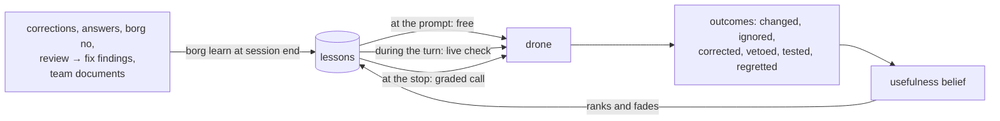
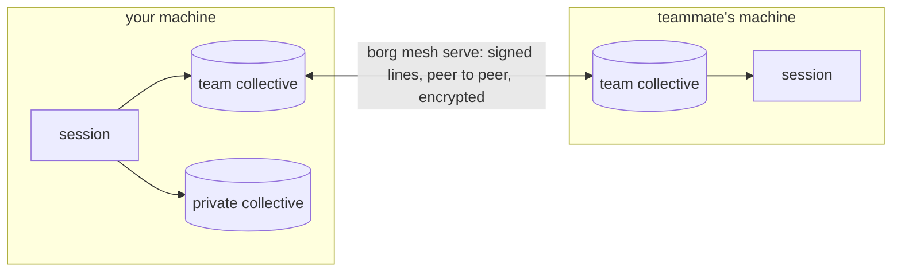

<p align="center"></p>

# Borg

[](https://github.com/debe/borg_ai/actions/workflows/ci.yml)
[](https://github.com/debe/borg_ai/actions/workflows/release.yml)
[](https://crates.io/crates/borg-ai)
[](https://github.com/debe/borg_ai/releases/latest)
[](https://github.com/debe/borg_ai/blob/main/Cargo.toml)
[](https://github.com/debe/borg_ai/blob/main/LICENSE-MIT)

Borg is a shared memory for coding agents. It turns the corrections you give your agent, and your team's
written knowledge, into short lessons, and brings each lesson back when a later session, yours or a
teammate's, meets the same decision. It runs as hooks in Claude Code and Codex and as extensions in omp
(oh-my-pi) and opencode, learns in one plain session with nothing else running, and shares lessons with a
team peer to peer, with no server.

Why: an agent forgets a correction when its session ends, so you make the same correction next week, and
each teammate makes it again.

- **Lesson:** what a correction becomes: a question the agent asks itself, the situations where it
  applies, and the consequence it prevents.
- **Drone:** one agent session wired to Borg.
- **Collective:** one memory for a set of repos: shared with a team, private, or off.
- **Queen:** the queue of decisions no lesson answers yet, asked of you one at a time.

**Status:** 0.7.0. A store outside Borg can take over long-term knowledge: Borg stops delivering a
lesson held there and keeps counting the corrections that recur. Lesson selection is measured end to
end, and the learned policy is the default since its pre-registered checks passed
(`BORG_SELECT=fixed` keeps the fixed rule). Messages between sessions are paced by acknowledgements
instead of a fixed rate. In daily use, with lessons syncing
between engineers' machines over the mesh, across NATs. Tested on Linux and macOS. Read [Evidence and limits](#evidence-and-limits) before you rely on it.

- [Quick start](#quick-start)
- [How it works in one session](#how-it-works-in-one-session)
- [The team](#the-team)
- [Talking to other sessions](#talking-to-other-sessions)
- [Handing knowledge to an outside store](#handing-knowledge-to-an-outside-store)
- [Monitoring](#monitoring)
- [Cost](#cost)
- [Privacy](#privacy)
- [Evidence and limits](#evidence-and-limits)
- [Upgrade and uninstall](#upgrade-and-uninstall)
- [Development](#development)

## Quick start

```sh
curl -fsSL https://raw.githubusercontent.com/debe/borg_ai/main/scripts/install.sh | sh
```

This installs prebuilt, sha256-checked `borg`, `borg-mesh` and `borg-web` into `~/.local/bin` (Linux
x86_64/arm64, macOS on Apple silicon) and runs `borg setup`. Setup asks which harnesses to wire, which
repos go to a private or team collective and which stay `off`, fetches the vector model (~490 MB, once),
optionally learns the 50 newest corrections from your past sessions, shows every change, writes nothing
until you confirm, and ends with `borg doctor`. A second run changes nothing. Then start your agent as
usual:

| Harness | After setup | Notes |
|---|---|---|
| Claude Code | `claude` | Every feature. Hooks in `~/.claude/settings.json` |
| omp 18.8.5, 18.10.4 | `omp` | Live mode needs omp 18.4.4 or newer. [adapters/omp](https://github.com/debe/borg_ai/blob/main/adapters/omp/README.md) |
| opencode 1.18.32, 1.19.0, 2.0.23, 2.0.29 | `opencode` | [adapters/opencode](https://github.com/debe/borg_ai/blob/main/adapters/opencode/README.md) |
| Codex CLI 0.153.2 | `codex`, then `/hooks` once to trust borg's hooks | Hooks in `~/.codex/hooks.json`; `borg doctor` says when codex skips them. Borg's own model calls need `claude`, `omp` or `opencode` on `PATH`, or `BORG_PREDICT_MODEL=codex:<model>` and `BORG_LEARN_MODEL=codex:<model>`. [adapters/codex](https://github.com/debe/borg_ai/blob/main/adapters/codex/README.md) |

Borg's model steps (learning, the checks) run headless through a logged-in CLI on `PATH`, the drone's
own harness first (Sonnet by default for `claude`). Without one, Borg still records episodes and delivers
by word matching, but learns nothing.

**Other ways in.** `install.sh` takes `--version`, `--dir` and `--no-setup` after `sh -s --`. From
crates.io: `cargo install borg-ai --locked` (plus `borg-mesh` for a team, `borg-web` for the page; Rust
1.91+; `--no-default-features` builds a lean `borg` without vectors). Setup flags answer its questions for
scripts:

```sh
borg setup --yes --private ~/src                              # no questions; defaults for the rest
borg setup --team platform --paths ~/work --relay disabled    # found a team collective
borg setup --join BORG1... --paths ~/work                     # join one with a ticket
borg setup --no-vectors --harness claude,codex
```

By hand: write `~/.config/borg/collectives.json` ([Collectives](https://github.com/debe/borg_ai/blob/main/docs/configuration.md#collectives); without
one every repo joins a team collective named `default`), then `borg install all` (a dry run) and
`borg install all --apply`, `borg vectors --fetch`, and optionally `borg assimilate --apply --limit 50`.
Intel Macs, the macOS C++ header workaround and source builds: [Install](https://github.com/debe/borg_ai/blob/main/docs/configuration.md#install).

Reference: [How one session learns](https://github.com/debe/borg_ai/blob/main/docs/learning.md) · [Delivery and modes](https://github.com/debe/borg_ai/blob/main/docs/delivery.md) ·
[Commands](https://github.com/debe/borg_ai/blob/main/docs/commands.md) · [Configuration](https://github.com/debe/borg_ai/blob/main/docs/configuration.md) · [Team sync](https://github.com/debe/borg_ai/blob/main/docs/team-sync.md) ·
[Statistics and the page](https://github.com/debe/borg_ai/blob/main/docs/statistics.md) · [Harnesses](https://github.com/debe/borg_ai/blob/main/docs/harnesses.md) · [Own relay](https://github.com/debe/borg_ai/blob/main/docs/relay.md) ·
[Evidence](https://github.com/debe/borg_ai/blob/main/docs/evidence.md) · [Roadmap](https://github.com/debe/borg_ai/blob/main/docs/roadmap.md) · [Reports](https://github.com/debe/borg_ai/tree/main/reports)

## How it works in one session

Everything in this section works in one plain interactive session, with no team.



**Learning.** Borg records an *episode* when you push back ("no, use a channel") or reject a tool call
with a reason. Your answers to the agent's own questions (Claude Code `AskUserQuestion`, omp `ask`,
opencode `question`, Codex `request_user_input`) are episodes too. Borg reads each harness's own
transcript beside its hooks, so a harness update cannot silence them. At session end `borg learn`
makes one model call per episode and writes or updates a lesson. Team documents become lessons through `borg assimilate --from-dir`.
[Sources of lessons](https://github.com/debe/borg_ai/blob/main/docs/learning.md#sources-of-lessons)

**Delivery.** Lessons arrive at three moments. *At the prompt or a touched file*, free, by word matching
(Claude Code; ratified constraints on every harness). *During the turn*, in live mode (the default): after
an edit a background check grades the work so far and its questions arrive with the next tool call. *At
the stop*, a free word gate skips most turns; otherwise one model call grades the eligible lessons, and a
grade 3 blocks the stop for one more round. The same call judges whether what was handed over earlier
changed the work. `"mode": "hook"` checks only at the stop. [Delivery and modes](https://github.com/debe/borg_ai/blob/main/docs/delivery.md)

**Which lessons are asked.** Per check, a selection policy decides for each graded lesson whether to
ask it, hand it over free or leave it for later. The reference is 0.5.0's fixed rule, by grade (it no
longer hands over free a lesson the session already had; `BORG_SELECT=fixed`). Every check also
measures what a learned policy needs and the fixed rule's history cannot show: a placebo arm judges
blindly up to two lessons the check does not deliver, a tail sample grades up to two lessons past the
pool's budget, and the records say which lessons the session already had. The learned policy, the
default, routes by the mistakes it expects each route to avoid, learned from the logged outcomes, and
deviates from the fixed rule only where the outcomes show it gains. On live checks it learns how many
lessons to ask by a randomised test that moves lessons between asked and handed over, never withholding
one. A conservative gate, rationed by the collective's optional `risk` (10% of the fixed rule's quality
by default), keeps it on the fixed rule until the outcomes support a deviation, and a monitor puts the
fixed rule back for good if it sees harm. [Which lessons are asked](https://github.com/debe/borg_ai/blob/main/docs/delivery.md#which-lessons-are-asked)

**Outcomes and belief.** Every delivery is logged with the check that routed it and its probability,
and what followed (changed, ignored, corrected anyway, vetoed, regretted, tested) moves the lesson's
usefulness belief; a lesson nobody judged counts as unknown, not as ignored. The
Knowledge tab of `borg web` shows it. [Outcomes](https://github.com/debe/borg_ai/blob/main/docs/learning.md#outcomes-and-the-usefulness-belief)

**Review → fix.** A reviewer sub-agent finds a bug and a fix step fixes it before any commit. `borg
review-fix` reads those runs from Claude Code, omp, opencode and Codex at 0 tokens, and each fixed finding
becomes a lesson for the moment of building. On by default. [Review → fix](https://github.com/debe/borg_ai/blob/main/docs/configuration.md#review--fix-findings)

**Regret.** A later commit that fixes an earlier decision is linked to it (`borg why` shows both ends).
With `BORG_REGRESS=learn` the fix becomes a lesson for the decision point; links only, by default. A
regret also counts against the lessons asked before the decision. [Decision → fix links](https://github.com/debe/borg_ai/blob/main/docs/configuration.md#decision--fix-links)

**Green tests.** When a lesson was asked and the session's own tests then went from red to green, or
passed after the drone changed its work on the point, the lesson gets a `tested` credit at 0 tokens.
[Green tests](https://github.com/debe/borg_ai/blob/main/docs/learning.md#outcomes-and-the-usefulness-belief)

**`borg no <reason>`** (or a prompt starting "borg no") vetoes what the drone is doing: the
lessons it was shown lose credit, the reason becomes a lesson (learned like a correction), and an invariant in it is proposed as a
constraint you can ratify. [Saying no](https://github.com/debe/borg_ai/blob/main/docs/learning.md#saying-no)

**Memory.** Use strengthens a lesson, disuse fades it: about 54 sessions without use make it dormant,
never deleted. The clock counts sessions, not days. [Memory](https://github.com/debe/borg_ai/blob/main/docs/learning.md#memory)

**The queen** holds decisions no lesson answers (open decisions from documents, proposed constraints).
The drone asks you one at a session's first prompt; `borg queen` lists them.
[The queen](https://github.com/debe/borg_ai/blob/main/docs/learning.md#the-queen)

## The team

Each repo belongs to one collective: **team** (synced to its members), **private** (`"share": "local"`,
never leaves the machine) or **off** (Borg reads and writes nothing). A correction about the code becomes
a team lesson; one about how *you* like the agent to work goes to your private collective; a repo
convention is delivered only in its repo. [Who hears a lesson](https://github.com/debe/borg_ai/blob/main/docs/configuration.md#who-hears-a-lesson)



Each machine runs `borg mesh serve`. Peers find each other by key over iroh, through NAT or a relay, and
reconcile append-only files by hash. Hooks only read and write local files, so nothing waits on the mesh.
What syncs and what stays is under [Privacy](#privacy). `borg top` is a live screen of the team's drones, like Unix `top`;
`borg pause` and `borg resume` hold or release any of them ([Talking to other sessions](#talking-to-other-sessions)). Set up: `borg setup --team <name>` or `--join <ticket>`, or
[Team sync](https://github.com/debe/borg_ai/blob/main/docs/team-sync.md); for a company, [Company collective](https://github.com/debe/borg_ai/blob/main/docs/team-sync.md#company-collective).

## Talking to other sessions

Sessions in one collective can message each other, whatever harness runs them and whichever member's
machine they are on. A session or the engineer's terminal sends:

```sh
borg tell Two "the schema change is merged, rebase before you touch migrations"
borg ask local "is anyone editing crates/borg/src/hook.rs?"        # the sessions on this machine
borg tell collective "the staging database is down until noon"     # every session, every member's machine
borg inbox      # in a session: its messages; in a terminal: every message of the last 7 days
```

The recipient is a drone as `borg top` names it, a session id, `local`, `collective` (or `all`, the
same) or `engineer`. Local first: `local` reaches the sessions running on this machine, and a drone or
session id that matches one here names it. A colleague's session is reached by `<session>@<node>`, when
nothing here matches, or as the sender a reply answers; `collective` reaches every session of the
collective on every member's machine and may wake them, so it is for what concerns their work. The message is shown once, at the recipient's next prompt or tool call, marked as
peer data rather than the user's words, with the command that replies (`borg tell <session> --re <id>`).
Text is redacted and kept whole; a message longer than one prompt or tool call has room for shows its
head and `borg inbox --show <id>`. A sender may have a window of unread messages to one recipient: it
starts at one and doubles each time the recipient reads one, so sessions that read their messages
converse without waiting, and a flood into a session that is gone stops at one. Where an
acknowledgement may never come, nobody is paced more strictly than 0.5.0 paced them, one message per 10
minutes: a broadcast or a message to the engineer may go at that rate whatever the window holds, and a
session on another machine is paced by that rate alone until its machine acknowledges one of the
sender's messages (a 0.5 machine never does). `borg inbox`, `borg top` and borg web's Messages page
acknowledge the messages to the engineer they show. Messages are kept 7 days. One to `local` stays on
this machine; one to `collective`, to `<session>@<node>` or a reply syncs to the team collective's
members.

The engineer can also hold a session, or every one:

```sh
borg pause Two "wait for the schema change"   # its tool calls are refused, with the note, until resumed
borg resume Two
borg no --session Two "never look merges up in the commit log"   # a veto, on this or another machine
```

`borg pause local` holds this machine's sessions; `borg pause collective` (or `all`) every member's.
These are messages too, shown at the next prompt or tool call on every harness, and never held back
by a sender's window.
From another member's machine they count only if that member has the `admin` or `steer` role. A pause
lapses after a day.

A session that is idle sees a message when it next runs, unless it listens. Inside a session:

```sh
borg listen         # wake this session when a message arrives while it is idle
borg listen --off
```

The opt-in lasts until `--off` or the session's end.

When its turn ends, borg wakes it in the way its harness allows. On Claude Code the model starts
`borg listen --wait` in the background. The omp and opencode adapters keep a stream running. On codex a
detached waiter queues a turn with `codex queue`. The wake names who wrote and how many messages wait,
and the session's next prompt hook shows the messages themselves. Nothing wakes a session while the
engineer's own turn runs. `borg top` shows who listens in its WAKE column.
[Commands](https://github.com/debe/borg_ai/blob/main/docs/commands.md#messages)

## Handing knowledge to an outside store

A team may keep its settled knowledge outside Borg, for example in a reviewed skills repo. Once a
lesson is held there, Borg delivering it too is a second copy that can drift. Borg does not know that
store and never names it. You ask your agent what is ready to be held elsewhere, and it runs:

```sh
borg memory export --json                                   # every lesson's evidence, 0 tokens
borg memory absorb L42 --note "skills/review@2026-10-30"    # held elsewhere now
borg memory release L42                                     # Borg delivers it again
```

- **The export** holds one record per lesson: the lesson as stored, its belief with a 95% credible
  interval, how many sessions and repos it changed work in, the raw placebo and tail counts, and
  whether it is absorbed. It is read-only. A field the logs do not hold is left out, never guessed.
- **An absorb** stops delivery of that lesson on every harness and every path: early delivery, the
  checks, the vector shortlist. In a team collective it syncs to the members; in a private one it
  stays on the machine. A constraint ratified from the lesson is still delivered.
- **The note** is an opaque label of at most 1,000 characters. Borg stores, syncs and shows it, and
  never reads it. What Borg acts on is the absorbed state alone.
- **Recurrence keeps measuring.** Learning still sees an absorbed lesson, so a repeated correction can
  merge into it. Each such merge counts as a recurrence: a sign the outside copy did not hold.
  `borg status` shows `absorbed N, recurred R` per collective, and borg web's Knowledge view marks
  absorbed lessons with their note and recurrence.

[Details](https://github.com/debe/borg_ai/blob/main/docs/learning.md#handing-a-lesson-to-an-outside-store)

## Monitoring

```sh
borg web        # http://127.0.0.1:7979/, the collective of the current directory first
```

A live page on 127.0.0.1 with tabs for the Overview, Knowledge (every lesson, its belief and state),
Conscience (checks, questions and what they led to per channel), Learning (week by week: lessons per
source, the share of asked lessons that changed the work, repeated vetoes), Steering
(corrections, rejected tool calls, pauses and vetoes, the tool calls a pause refused), Messages (the last
7 days' conversation, sends and refusals), the Queen (open questions, the queen's attention score), Cost and Drones.
The Conscience tab also shows lesson selection: the policy and the default, what the checks measure
for the learned policy (placebos drawn and judged, tail lessons shown and applied), spend per session,
effects with their intervals, label health, the fitted delivery rates, pool yield and stop latency per
harness against its stop budget, and the learned decisions a guard gave the fixed rule; under the
learned policy also its gate, the checks it deviated from the fixed rule on (on evidence or by a test draw), the question-count test (checks drawn,
refused by the gate, the draws, the risk share in force, the readout once due) and the monitor's reading
with the health of its weights. It reads the same files as `borg top` and needs no mesh. In the terminal: `borg status` (modes, stores, lesson selection, what is wired,
spend), `borg doctor` (what is broken), `borg queen`, `borg top`.
[Statistics and the page](https://github.com/debe/borg_ai/blob/main/docs/statistics.md)

## Cost

- **Most turn ends cost 0 tokens** in hook mode: the free gate skipped 78% of 1,117 real turn ends. Early delivery
  and grade-2 and grade-1 lessons never call a model; they are judged only inside a call a question pays
  for.
- **A turn-end call** costs about $0.07 (Sonnet, mean over 67 calls) and takes about 10 s. An extra round
  happens only for a grade-3 lesson.
- **Live mode** adds one call per burst of changes: about 8× borg's own spend in hook mode, while whole
  runs cost about the same ([Why live is the default](https://github.com/debe/borg_ai/blob/main/docs/delivery.md#why-live-is-the-default)).
- **Learning** costs about $0.02 per correction (21 lessons from 10 sessions: $0.66). `assimilate --from-dir` makes one call per chunk and
  prints its cost. Messages, `borg no`, review → fix, regrets and green tests are found at 0 tokens; a
  veto's reason or a fixed finding is then learned like any correction.
- There is no cost cap. Quality is what selection optimises; `borg status`, `borg top` and the Cost and
  Conscience tabs show what each mode and each check spent. An engineer who wants spend priced sets an
  optional `budget` for a collective, which prices the learned policy's pools ([Collectives](https://github.com/debe/borg_ai/blob/main/docs/configuration.md#collectives)); none is set by default.
- **The tail sample** adds at most two lessons to a turn-end call whose pool (12,000 tokens) left
  lessons out, so the yield past the budget is measured.

## Privacy

**Stays on your machine:** everything from off repos and private collectives; raw episodes (your exact
corrections), transcripts, the shell output adapters hand to borg, source code, `collectives.json`,
per-session state.

**Goes to team members,** for team collectives only, each line signed and dropped on revocation:
lessons (with author emails and repo names); redacted reasoning excerpts of landed commits, each held by
two members; decision → fix links; presence for `borg top` (harness, email, repo, the redacted first line
of your latest prompt, touched paths); redacted messages between sessions, pauses, resumes and vetoes among them, and which messages a session was shown (the acknowledgements that pace them); the signed member list; daily usage counts per
engineer; outcomes with session, repo and regret hashed (`BORG_SHARE_OUTCOMES=off` keeps them local);
and ratified constraints (the invariant, its lesson and who ratified it, never the veto's words).

**A mesh relay** sees node ids, IP addresses and traffic volume, never content; run your own to keep even
that in-house ([Privacy on the mesh](https://github.com/debe/borg_ai/blob/main/docs/team-sync.md#privacy-on-the-mesh), [Own relay](https://github.com/debe/borg_ai/blob/main/docs/relay.md)).
**The model provider** receives what each model step needs: the turn and the eligible lessons, or the
episode being learned.

Redaction (`redact` in `crates/borg/src/notes.rs`) strips tokens, keys, passwords and `.env` values from
excerpts and presence. Lessons skip it: the model writes them as general questions, but read
`lessons.jsonl` before you share a collective that handled secrets.

**Hooks fail open.** A missing binary, a crash, an invalid config, an unreachable model or a locked index
lets the agent continue untouched. A turn-end call that fails ends the turn without questions, a live
check that fails asks nothing (the turn end then checks as in hook mode), and unlearned episodes wait for
the next run. [Time limits](https://github.com/debe/borg_ai/blob/main/docs/delivery.md#delivery-modes)

## Evidence and limits

**Measured, against rules written before each paid run** (mostly on the author's and a few colleagues'
sessions, so the data is not here):

- lessons at the turn end, 15 real decisions in a sealed sandbox: 25% → 34% engineer points on all 15,
  +8.8 [−1.4, +22.2], not significant; 34% → 63% on the subgroup of 4 cases with a directly relevant
  lesson, +29.2 [+4.2, +68.8];
- a memory of 21 lessons from 10 sessions held 21 useful ones; accuracy tied with Hindsight on the same
  memory model;
- the system gate cut wrong-system deliveries from 83 to 0;
- live mode: not worse than hook (+0.38 criteria per task [0, +0.88], 8 pairs, p = 0.50, directional
  only: 2 pairs differ; 0 redo rounds).

**On although its rule was not met:** review → fix lessons, +6.3 points of later bugs avoided
[−5.1, +17.9]; the pre-registered rule (an interval excluding 0) failed, and the engineer turned it on so
that users who never configure get it.

**Rule not met:** team documents as lessons, n = 9: +1.7 [+0.8, +2.4] knowledge checks over a plain agent
(comparison runs not concurrent), but against a hand-written skill +0.11 [−0.56, +0.78], short of the
pre-registered lower bound of −0.5.

**Shown, the default since:** learned lesson selection. Its checks were written before it was built
and run at 0 tokens (`borg debug select --replay`). The first design failed P4 on their first run and
again on the one rerun their amended rules allow: on the review → fix eval the right lesson's recall
against the fixed rule was −3.53 points [−6.74, −0.98] under the store's posterior and −3.77 [−6.89,
−1.18] under the n = 0 prior (first run −4.02 [−7.28, −1.24] under the posterior), both lower bounds
past the bar's −5. The failure was the design (one random draw of the model let unidentified effects
decide from their priors), so the policy was redesigned to deviate only on evidence and to learn the
question count by a randomised test, under checks written before the rebuild (Rules v2). Their one run
passed P0–P3 (P2 by the pruned model), P4a (with no outcomes it is the fixed rule on every evaluation
check) and P4c (the test keeps the fixed rule's recall, 76.2%); P4b was NOT TESTED, since under the
store's posterior it deviated on none of the evaluation's checks, and the P4 cases had been seen a third
time. So the learned policy is the default; today it differs from the fixed rule by the question-count
test on live checks, and `BORG_SELECT=fixed` keeps the fixed rule ([Lesson selection](https://github.com/debe/borg_ai/blob/main/docs/evidence.md#lesson-selection)).

**Not shown:** that Borg helps strangers on public data (SWE-chat: no memory helped, Borg included);
decision → fix precision on real history (so `BORG_REGRESS` stays `links`); whether the regret credit
improves the belief (the check was inconclusive: no data yet); the weights of vetoes and green tests. omp,
opencode and Codex get no early delivery of ordinary lessons, and there a live check sees tool calls,
not prose.
Full table, the regret check and every known limit: [Evidence and limits](https://github.com/debe/borg_ai/blob/main/docs/evidence.md).

## Upgrade and uninstall

```sh
borg update            # install the latest release, refresh the wiring, run borg doctor
borg update --check    # only ask: exit 10 when a newer release exists, and who on the team runs what
```

`borg update` installs the way borg was installed: under `~/.cargo/bin` (`$CARGO_HOME/bin`) it runs
`cargo install --locked --force --version X` for `borg-mesh`, `borg-web` and then `borg-ai`; otherwise
it downloads the release tarball `install.sh` uses, checks its sha256 and replaces `borg-mesh`,
`borg-web` and then `borg` beside `borg` (a `BORG_BIN` symlink counts where it points). `borg` comes
last, so an install that stopped part way leaves the old `borg`, and the next `borg update` starts
again; on the current release it also reinstalls a `borg-mesh` or `borg-web` beside `borg` that
reports another version. A build under `target/` or a platform without release binaries gets the
commands printed instead, and nothing changes. Then the new borg refreshes every harness that is wired now
(`borg install <h> --apply`: adapter, skill and hooks; it never wires a new one) and runs
`borg doctor`. The mesh daemon and `borg listen` waiters restart on their own; restart a running
`borg web`, which `borg update` names. Before 0.7 there is no `borg update`: run `install.sh` again or
`cargo install borg-mesh borg-web borg-ai --locked --force`, then `borg install all --apply` and
`borg doctor`.

**You hear of an update without asking.** Once a day the prompt hook starts `borg update --check` in
the background; it never waits for the network. When a newer release exists, the drone hears it once
per session, tells you, and offers to run `borg update`, which it runs only on your yes. It also tells
you when nothing syncs with a team member because that member speaks a newer mesh protocol, and when
a member runs a newer released borg. `borg status` lists this borg, the latest release and the team's
members by version; `borg doctor` warns about a newer release; `borg top` and `borg web` show one line
or a banner while an update exists or a member's protocol differs. When a node first syncs with a member
on an older protocol, it tells the whole collective once, as a message every borg since 0.4 shows:
who runs which borg, what the older members miss, and the command to run
([Versions on the mesh](https://github.com/debe/borg_ai/blob/main/docs/team-sync.md#how-a-sync-works)). `BORG_UPDATE_CHECK=off` turns the release
check off, `BORG_ANNOUNCE=off` the message ([variables](https://github.com/debe/borg_ai/blob/main/docs/configuration.md#environment-variables)).

Hooks call the binary by path, so a reinstall needs no rewiring. Codex trusts each hook's command and
timeout: after an upgrade that moves borg or changes a timeout, trust them again with `/hooks`
(`borg doctor` says so). Stores are append-only JSONL and need no migration; the first check after an
upgrade rebuilds the selection summary from the outcome log. The mesh protocol is now `borg/mesh/15`.
A 0.6 member (`borg/mesh/14`) syncs everything except absorbs: it keeps delivering a lesson the team
absorbed until it upgrades. A 0.4 or 0.5 member (`borg/mesh/13`) syncs the same, but gets only the
messages it can read (those of at most 1,000 characters, paced as 0.5.0 paced them): `borg tell`
refuses a longer text to a session there and says why, and a broadcast says how many member machines
will not show it. A member built from 0.3.0 sources (`borg/mesh/12`) syncs everything except messages
and absorbs; nothing syncs with an older one, and `borg doctor` names that member and which side has
to upgrade.

```sh
borg uninstall all --apply    # removes only what install added; keeps a backup
cargo uninstall borg-ai borg-mesh borg-web    # or delete them from ~/.local/bin after install.sh
```

Uninstall leaves an edited adapter or skill file in place and reports it. Your data stays: delete
`~/.local/share/borg` and `~/.config/borg` to remove it, and `git update-ref -d refs/notes/borg` in each
repo for the reasoning notes.

## Development

```sh
scripts/check.sh                              # everything below; run before a release
cargo test --workspace
cargo test -p borg-ai --no-default-features   # the lean build
cargo clippy --workspace --all-targets -- -D warnings
cargo fmt --all                               # max_width 160
node --test adapters/omp/borg.test.ts         # adapter tests; need target/debug/borg and Node 23.6+ or bun
node --test adapters/opencode/borg.test.ts
node --test adapters/conformance/conformance.test.ts   # harness conformance (docs/harnesses.md)
scripts/arch.sh                               # the harness abstraction's metrics and gates
scripts/ui.sh                                 # rebuilds the page's committed dist/ (check.sh checks it is fresh)
python3 scripts/figures.py                    # regenerates the figures in docs/img
```

| Path | What |
|---|---|
| `crates/borg` | The product (crate `borg-ai`, binary and library `borg`): CLI, hooks, learning, checks, memory, collectives, install, vectors. `assets/` holds the skill and the TS adapters it compiles in |
| `crates/borg-mesh` | Peer sync, membership, presence, admission of pauses and vetoes from other machines (iroh); separate so the hook binary stays small |
| `crates/borg-trace` | Parses Claude Code and omp transcripts |
| `crates/borg-web` | `borg web`, the live page; `dist/` is its built Leptos client (`ui/`), committed |
| `crates/borg-eval`, `crates/borg-search`, `eval/` | Eval harness and benchmarks; not shipped, use local paths under `~/.local/share/borg/eval/` |
| `adapters/omp`, `adapters/opencode` | TypeScript adapters, compiled into `borg` (`borg.ts` links to `crates/borg/assets/adapters/`) |
| `adapters/codex` | How the Codex hooks are wired and what they miss |
| `adapters/conformance` | The harness conformance suite ([Harnesses](https://github.com/debe/borg_ai/blob/main/docs/harnesses.md): one module per agent behind one trait) |
| `skills/borg` | The `borg` skill `borg install` copies into each harness (a link to `crates/borg/assets/skills/borg`) |
| `reports/` | Measured results |

Contributing: [CONTRIBUTING.md](https://github.com/debe/borg_ai/blob/main/CONTRIBUTING.md). Security reports: [SECURITY.md](https://github.com/debe/borg_ai/blob/main/SECURITY.md).
License: MIT OR Apache-2.0 ([LICENSE-MIT](https://github.com/debe/borg_ai/blob/main/LICENSE-MIT), [LICENSE-APACHE](https://github.com/debe/borg_ai/blob/main/LICENSE-APACHE)).
