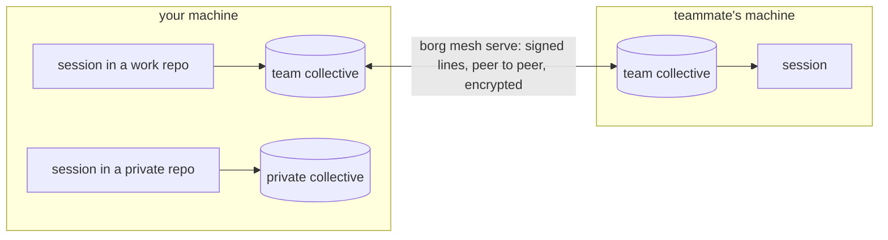
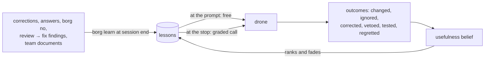

<p align="center"></p>

# Borg

[](https://github.com/debe/borg_ai/actions/workflows/ci.yml)
[](https://github.com/debe/borg_ai/actions/workflows/release.yml)
[](https://crates.io/crates/borg-ai)
[](https://github.com/debe/borg_ai/releases/latest)
[](https://github.com/debe/borg_ai/blob/main/Cargo.toml)
[](https://github.com/debe/borg_ai/blob/main/LICENSE-MIT)

**Collaborative working with a conscience, for coding agents.**

Your agent session tells a colleague's sessions what it is about to change and asks what they know,
whether they run Claude Code, opencode, omp or Codex, on any machine of the team. You see every session
the team runs, hold one that is about to break something, and hand work in progress to another
session.

Each session also has a conscience. An agent forgets a correction when its session ends, so you make
the same correction next week, and each teammate makes it again. Borg turns the corrections you give
your agent into short lessons, and when a later session, yours or a teammate's, meets the same
decision, it asks the agent the question the correction taught. What the agent does next raises or
lowers that lesson's rank; unused lessons fade.

Borg works with Claude Code, opencode, omp (oh-my-pi) and Codex: hooks in Claude Code and Codex,
extensions in opencode and omp. It shares with the team peer to peer, with no server. It is in daily
use by a team on Linux and macOS, syncing across NATs; read [Evidence and limits](#evidence-and-limits)
before you rely on it.

- [What we see in daily use](#what-we-see-in-daily-use)
- [Quick start](#quick-start)
- **Collaborate:** [Talking to other sessions](#talking-to-other-sessions) ·
  [Handing work off](#handing-work-off) · [The team](#the-team)
- **Conscience:** [How a session learns](#how-a-session-learns) ·
  [Handing knowledge to an outside store](#handing-knowledge-to-an-outside-store)
- [Monitoring](#monitoring) · [Cost](#cost) · [Privacy](#privacy) ·
  [Evidence and limits](#evidence-and-limits) · [Upgrade and uninstall](#upgrade-and-uninstall) ·
  [Development](#development)

## What we see in daily use

The conscience does what we built it for, and it shows: a correction given once comes back as a
question when the next session, ours or a teammate's, meets the same decision, and the agent changes
its work before anyone has to say it again. [Evidence and limits](#evidence-and-limits) has what is
measured.

What we did not expect is how much we would use the messages between sessions. Before a change that
may reach into a colleague's work, we tell our agent something like:

> Tell my teammate's sessions on billing where story 275 stands and that we are changing the invoice
> schema. Ask whether that breaks anything of theirs, and whether they have something new that matters
> for this repo or this story.

The agent sends it:

```sh
borg tell <teammate> --on billing "Story 275: invoice totals done, now changing the invoice schema (amount → amount_cents)."
borg ask <teammate> --on billing "Does the schema change break anything of yours? Anything new for billing or story 275?"
```

Every live session of that teammate whose repo, prompt or recent files mention `billing` gets the
message at its next prompt or tool call. A session that sits idle is woken. The message arrives marked as
a colleague's words, not its engineer's, with the command that replies, and the answer comes back the
same way into the session that asked. The colleague's agent answers from the session it has open;
nobody pastes context across.

In the seven days to 27 November 2026 our team's sessions sent each other 66 messages from 4 machines
(60 tells, 6 asks), every one from an agent session, none from a terminal. On one machine the weekly count
rose from 3 to 47 over five weeks.

Terms used below:

- **Drone:** one agent session wired to Borg.
- **Collective:** one shared memory and message space for a set of repos: shared with a team, private,
  or off.
- **Lesson:** what a correction becomes: a question the agent asks itself, the situations where it
  applies, and the consequence it prevents.
- **Conscience:** the lessons and the check at the end of each turn that asks the ones that apply.
- **Queen:** the queue of decisions no lesson answers yet, asked of you one at a time.

## Quick start

```sh
curl -fsSL https://raw.githubusercontent.com/debe/borg_ai/main/scripts/install.sh | sh
```

This installs prebuilt, sha256-checked `borg`, `borg-mesh` and `borg-web` into `~/.local/bin` (Linux
x86_64/arm64, macOS on Apple silicon) and runs `borg setup`. Setup asks which harnesses to wire, which
repos go to a private or team collective and which stay `off`, fetches the vector model (~490 MB, once),
optionally learns the 50 newest corrections from your past sessions, shows every change, writes nothing
until you confirm, and ends with `borg doctor`. A second run changes nothing. Then start your agent as
usual:

| Harness | After setup | Notes |
|---|---|---|
| Claude Code | `claude` | Every feature. Hooks in `~/.claude/settings.json` |
| opencode 1.18.32, 1.19.0, 2.0.23, 2.0.29 | `opencode` | [adapters/opencode](https://github.com/debe/borg_ai/blob/main/adapters/opencode/README.md) |
| omp 18.8.5, 18.10.4, 18.15.0 | `omp` | A tool call's context needs omp 18.4.4 or newer. [adapters/omp](https://github.com/debe/borg_ai/blob/main/adapters/omp/README.md) |
| Codex CLI 0.153.2 | `codex`, then `/hooks` once to trust borg's hooks | Hooks in `~/.codex/hooks.json`; `borg doctor` says when codex skips them. Borg's own model calls need `claude`, `omp` or `opencode` on `PATH`, or `BORG_PREDICT_MODEL=codex:<model>` and `BORG_LEARN_MODEL=codex:<model>`. [adapters/codex](https://github.com/debe/borg_ai/blob/main/adapters/codex/README.md) |

Borg's model steps (learning, the checks) run headless through a logged-in CLI on `PATH`, the drone's
own harness first (Sonnet by default for `claude`). Without one, Borg still records episodes and delivers
by word matching, but learns nothing. Messages, hand-offs and `borg top` need no model at all.

**Other ways in.** `install.sh` takes `--version`, `--dir` and `--no-setup` after `sh -s --`. From
crates.io: `cargo install borg-ai --locked` (plus `borg-mesh` for a team, `borg-web` for the page; Rust
1.91+; `--no-default-features` builds a lean `borg` without vectors). Setup flags answer its questions for
scripts:

```sh
borg setup --yes --private ~/src                              # no questions; defaults for the rest
borg setup --team platform --paths ~/work --relay disabled    # found a team collective
borg setup --join BORG1... --paths ~/work                     # join one with a ticket
borg setup --no-vectors --harness claude,codex
```

By hand: write `~/.config/borg/collectives.json` ([Collectives](https://github.com/debe/borg_ai/blob/main/docs/configuration.md#collectives); without
one every repo joins a team collective named `default`), then `borg install all` (a dry run) and
`borg install all --apply`, `borg vectors --fetch`, and optionally `borg assimilate --apply --limit 50`.
Intel Macs, the macOS C++ header workaround and source builds: [Install](https://github.com/debe/borg_ai/blob/main/docs/configuration.md#install).

Reference: [How one session learns](https://github.com/debe/borg_ai/blob/main/docs/learning.md) · [Delivery](https://github.com/debe/borg_ai/blob/main/docs/delivery.md) ·
[Commands](https://github.com/debe/borg_ai/blob/main/docs/commands.md) · [Configuration](https://github.com/debe/borg_ai/blob/main/docs/configuration.md) · [Team sync](https://github.com/debe/borg_ai/blob/main/docs/team-sync.md) ·
[Statistics and the page](https://github.com/debe/borg_ai/blob/main/docs/statistics.md) · [Harnesses](https://github.com/debe/borg_ai/blob/main/docs/harnesses.md) · [Own relay](https://github.com/debe/borg_ai/blob/main/docs/relay.md) ·
[Evidence](https://github.com/debe/borg_ai/blob/main/docs/evidence.md) · [Roadmap](https://github.com/debe/borg_ai/blob/main/docs/roadmap.md) · [Reports](https://github.com/debe/borg_ai/tree/main/reports)

## Collaborate

### Talking to other sessions

Sessions in one collective message each other, whatever harness runs them and whichever member's
machine they are on. A session sends on its engineer's word, or the engineer sends from a terminal:

```sh
borg tell <teammate> --on billing "I took story 275, leave invoice.rs to me"  # their live sessions on billing
borg ask local "is anyone editing crates/borg/src/hook.rs?"                    # the sessions on this machine
borg tell 2 "the schema change is merged, rebase before you touch migrations"  # one drone, by its number
borg tell collective "the staging database is down until noon"                 # every session, every machine
borg inbox      # in a session: its messages; in a terminal: every message of the last 7 days
```

**Who receives it.** An engineer's name reaches their live sessions; `--on <topic>` keeps those whose
repo, prompt or one of their recent files, as `borg top` shows them, holds the topic, and `--state any`
adds sessions that ended within the day (shown only if that session resumes; `engineer:<email>`
reaches the engineer instead). A drone is named as `borg top` names it: its number, or its
label (`"<engineer> · borg-ai · claude"`), or its session id. `local` reaches the sessions on this
machine, `collective` (or `all`) every session of the collective on every member's machine, and
`engineer` the engineers themselves. Local comes first: a drone number or session id that matches a
session here names it, and one that matches nothing here reaches a colleague's session.
`<session>@<node>` always names one session exactly, and a reply goes back to the sender's session. `collective` may wake every session of the team, so use it for
what concerns their work.

**What arrives.** The message is shown once, at the recipient's next prompt or tool call, marked as
peer data rather than the user's words, with the command that replies (`borg tell <session> --re <id>`).
Text is redacted and kept whole; a message longer than one prompt or tool call has room for shows its
head and `borg inbox --show <id>`. `borg inbox`, `borg top` and borg web's Messages page acknowledge the
messages to the engineer they show. Messages are kept 7 days. Every message except one to `local`
syncs to the members of a team collective.

**Pacing.** A sender may have a window of unread messages to one recipient. It is earned between
machines: it doubles each time the recipient's machine reads a message from the sender's machine, up to
64, so the more two machines talk, the wider a new session's conversation opens. Nobody waits longer
than a minute: a minute after the sender's previous message the next one goes whatever the window holds.
A session on another machine that has read nothing from the sender's machine gets one message a minute.
When the window is full, `borg tell` refuses the message and says when it may go.

**Waking.** Every session listens from its first prompt: a message that arrives while it is idle wakes
it. Inside a session:

```sh
borg listen --off   # this session is no longer woken
borg listen         # woken again, and also for the questions the turn-end check leaves waiting
```

`BORG_LISTEN=off` keeps sessions from listening by themselves. When a listening session's turn ends,
Borg starts a waiter in the way its harness allows, with no model call, and the waiter starts the next
turn when a message arrives: on Claude Code a background Stop hook (`asyncRewake`), in opencode and omp
a stream the adapter keeps running, and on Codex a detached waiter that queues a turn with
`codex queue`. The wake names who wrote and how many messages wait, and the
session's next prompt hook shows the messages themselves. In a session where `borg listen` ran, the
questions a turn-end check left waiting wake it too, and the wake carries them; a wake that fails puts
them back, so the next prompt still asks them. Elsewhere they arrive with the next prompt or tool call.
Nothing wakes a session while the engineer's own turn runs. `borg top` shows who listens in its WAKE
column.

**Holding a session.** The engineer can stop a session, or every one, from going further:

```sh
borg pause Two "wait for the schema change"   # its tool calls are refused, with the note, until resumed
borg resume Two
borg no --session Two "never look merges up in the commit log"   # a veto, on this or another machine
```

`borg pause local` holds this machine's sessions; `borg pause collective` (or `all`) every member's.
Pauses, resumes and vetoes for another machine travel as messages, shown at the next prompt or tool
call on every harness and never held back by a sender's window. From another member's machine they count only if that member has the `admin` or
`steer` role. A pause lapses after a day.
[Messages](https://github.com/debe/borg_ai/blob/main/docs/commands.md#messages)

### Handing work off

A session can pass its work in progress to another drone, like a transferred call:

```sh
borg handoff "parser: error paths" --brief brief.md          # offer this session's work with its brief
borg handoff "…" --brief brief.md --to <teammate's email>    # ask someone in particular
borg handoff                                                 # the hand-offs of the whole team
borg handoff take h3f09a1c2b7d4                              # take one over
borg handoff abort h3f09a1c2b7d4 --why "wrong base"          # close it (owner, admin or steerer)
borg handoff done h3f09a1c2b7d4                              # finished: delete its refs
```

The agent writes the brief: the goal, where it stands, the plan, the next step, the decisions, the open
questions and how to verify. It comes from a file or stdin, never the command line.

The offer pushes the working tree of each repo the session started in or wrote to, each to its own
remote, as hand-off refs; the first repo's push also carries the brief and Borg's metadata, in one
atomic push. A repo the session only read is left out, and so are
ignored files, changes that add a secret, new binaries of a kind the repo does not track and files past
git's big-file threshold; untracked files go along. The engineer's branch, index and stash stay as they
were. The original keeps working until someone takes it, and each of its stops refreshes the offer.

The remote decides who takes it: a take creates the hand-off's `taken` ref there, and git refuses the
second create, so exactly one take wins. The taker gets branch `borg/handoff/<id>` in each repo it has a
clone of (the clone URL of each it has not) and reads the whole brief. From then on the original
session's edits in those repos are refused, while its reads still pass, and it is told which of its
changes came after the state taken. The offering engineer's own take is the take-back.

The news travels over the mesh: other machines list the offer, a session in a clone of the repo is told
at a prompt, and a take on another machine fences the original at once (one off the mesh learns it from
the remote at its next stop). `--to` first checks the team's signed presence (one of their machines
seen, on a borg that takes hand-offs, with a clone of the repo), then asks; `borg handoff decline <id>`
says no. An abort by the owner, an admin or a steerer and a take race for the same ref. An abort after a
take fences both sessions until `borg handoff done` deletes the refs. An admin can switch hand-offs off
for the collective (`borg handoff off`). `borg top` and borg web show them. Hand-offs exist in team
collectives only. [Hand-off](https://github.com/debe/borg_ai/blob/main/docs/handoff.md)

### The team

Each repo belongs to one collective: **team** (synced to its members), **private** (`"share": "local"`,
never leaves the machine) or **off** (Borg reads and writes nothing). A correction about the code becomes
a team lesson; one about how *you* like the agent to work stays personal, delivered only to you in the
collective it was learned in and never synced; a repo convention is delivered only in its repo. Nothing
crosses between collectives on its own: `borg move` and `borg correct --collective` cross on your word.
[Who hears a lesson](https://github.com/debe/borg_ai/blob/main/docs/configuration.md#who-hears-a-lesson)



Each machine runs `borg mesh serve`, a service once `borg setup` is done ([Services](#upgrade-and-uninstall)).
Peers find each other by key over iroh, through NAT or a relay, and reconcile append-only files by hash.
Hooks only read and write local files, so nothing waits on the mesh. What syncs and what stays is under
[Privacy](#privacy). `borg top` is a live screen of the team's drones, like Unix `top`, each labelled by
who runs it where (`<engineer> · borg-ai · claude`, with the host for a colleague's), and `borg web`
draws the same as a live cube. Set up: `borg setup --team <name>` or `--join <ticket>`, or
[Team sync](https://github.com/debe/borg_ai/blob/main/docs/team-sync.md); for a company, [Company collective](https://github.com/debe/borg_ai/blob/main/docs/team-sync.md#company-collective).

## Conscience

### How a session learns

Everything in this section works in one plain interactive session, with no team.



**Learning.** Borg records an *episode* when you push back ("no, use a channel", in any language: a model
judges each prompt at session end) or reject a tool call with a reason. Your answers to the agent's own
questions (Claude Code `AskUserQuestion`, opencode `question`, omp `ask`, Codex `request_user_input`) are
episodes too. Borg reads each harness's own transcript beside its hooks, so a harness update cannot
silence them. At session end `borg learn` makes one model call per episode and writes or updates a
lesson. Team documents become lessons through `borg assimilate --from-dir`.
[Sources of lessons](https://github.com/debe/borg_ai/blob/main/docs/learning.md#sources-of-lessons)

**Delivery.** Lessons arrive at two moments. *At the prompt or a touched file* they come free, by word
matching (Claude Code; ratified constraints on every harness), and so do graded lessons a stop handed
over. *At the stop*, a free word gate skips most turns; otherwise one model call grades the eligible
lessons. The stop never waits for it: the call runs detached, and its questions reach the agent with the
next prompt or tool call, as questions about the turn they judged, or wake a listening idle session. A
newer check settles an older waiting question, and one check runs per session (`BORG_ASYNC=off`: the
stop calls the model itself and a grade 3 blocks it for one more round). The same call judges whether
what was handed over earlier changed the work. Free hand-overs are judged at the turn end. At the
session's end, one more set of calls judges every delivery still open, in batches sized to what the
judge reads well. [Delivery](https://github.com/debe/borg_ai/blob/main/docs/delivery.md)

**Which lessons are asked.** Per check, a selection policy decides for each graded lesson whether to ask
it, hand it over free or leave it for later. The reference is a fixed rule by grade, which never
hands over free a lesson the session already had (`BORG_SELECT=fixed`). Every check also measures what a
learned policy needs and the fixed rule's history cannot show:

- a placebo arm: the judge grades, blind, up to two lessons the check does not deliver (under the
  fixed rule, those past its 10);
- when the token budget leaves lessons out, the last 15% of the pool is filled at random, and a
  sample of the left-out lessons that fits in another 15% (at least two) is graded too, each with its
  logged chance;
- the records say which lessons the session already had.

The learned policy, the default, routes by the mistakes it expects each route to avoid, learned from
the logged outcomes, and deviates from the fixed rule only where the outcomes show it gains. Sometimes
it holds back a lesson it would deliver and has the judge grade it anyway, so the value of not
delivering is measured too; the chance of holding back is the estimated chance the lesson is worth
nothing, it is logged, and the gate bounds the cost. A randomised test moves lessons between asked and handed over on checks that do not
block the stop; its readout showed no effect (2026-11-19). A conservative gate, rationed by the
collective's optional `risk` (10% of the fixed rule's quality by default), keeps the policy on the fixed
rule until the outcomes support a deviation, and a monitor puts the fixed rule back for good if it sees
harm. [Which lessons are asked](https://github.com/debe/borg_ai/blob/main/docs/delivery.md#which-lessons-are-asked)

**The pool log.** Each detached check logs every eligible lesson it could have shown, with its chance to
be shown and the scores of the candidate orders a pre-registered test will compare: word matches,
retrieval cues `borg learn` writes per lesson, the design moves of the previous check, the lesson's
value from its verdicts, vectors. They are logged only, never put in the prompt; `borg status` and
`borg web` show why first applies sat low in the order. [The pool log](https://github.com/debe/borg_ai/blob/main/docs/learning.md#the-pool-log)

**Outcomes and belief.** Every delivery is logged with the check that routed it and its probability,
and what followed (changed, ignored, corrected anyway, vetoed, regretted, tested) moves the lesson's
usefulness belief. A lesson nobody judged, or whose point never came up, counts as unknown, not as
ignored. The Knowledge tab of `borg web` shows it. [Outcomes](https://github.com/debe/borg_ai/blob/main/docs/learning.md#outcomes-and-the-usefulness-belief)

**Review → fix.** A reviewer sub-agent finds a bug and a fix step fixes it before any commit. `borg
review-fix` reads those runs from Claude Code, opencode, omp and Codex at 0 tokens, and each fixed
finding becomes a lesson for the moment of building. On by default. [Review → fix](https://github.com/debe/borg_ai/blob/main/docs/configuration.md#review--fix-findings)

**Regret.** A later commit that fixes an earlier decision is linked to it (`borg why` shows both ends).
With `BORG_REGRESS=learn` the fix becomes a lesson for the decision point; by default Borg only links
them. A regret also counts against the lessons asked before the decision. [Decision → fix links](https://github.com/debe/borg_ai/blob/main/docs/configuration.md#decision--fix-links)

**Green tests.** When a lesson was asked and the session's own tests then went from red to green, or
passed after the drone changed its work on the point, the lesson gets a `tested` credit at 0 tokens.
[Green tests](https://github.com/debe/borg_ai/blob/main/docs/learning.md#outcomes-and-the-usefulness-belief)

**`borg no <reason>`** (or a prompt starting "borg no") vetoes what the drone is doing: the lessons it
was shown lose credit, the reason becomes a lesson (learned like a correction), and an invariant in it is
proposed as a constraint you can ratify. [Saying no](https://github.com/debe/borg_ai/blob/main/docs/learning.md#saying-no)

**Memory.** Use strengthens a lesson and disuse fades it: about 54 sessions without use make it dormant,
never deleted. The clock counts sessions, not days. [Memory](https://github.com/debe/borg_ai/blob/main/docs/learning.md#memory)

**The queen** holds decisions no lesson answers (open decisions from documents, proposed constraints).
The drone asks you one at a session's first prompt; `borg queen` lists them.
[The queen](https://github.com/debe/borg_ai/blob/main/docs/learning.md#the-queen)

### Handing knowledge to an outside store

A team may keep its settled knowledge outside Borg, for example in a reviewed skills repo. Once a lesson
is held there, Borg delivering it too is a second copy that can drift. Borg does not know that store and
never names it. You ask your agent what is ready to be held elsewhere, and it runs:

```sh
borg memory export --json                                   # every lesson's evidence, 0 tokens
borg memory absorb L42 --note "skills/review@2026-10-30"    # held elsewhere now
borg memory release L42                                     # Borg delivers it again
```

- **The export** holds one record per lesson: the lesson as stored, its belief with a 95% credible
  interval, how many sessions and repos it changed work in, the raw placebo and tail counts, and
  whether it is absorbed. It is read-only. A field the logs do not hold is left out, never guessed.
- **An absorb** stops delivery of that lesson on every harness and every path: early delivery, the
  checks, the vector shortlist. In a team collective it syncs to the members; in a private one it
  stays on the machine. A constraint ratified from the lesson is still delivered.
- **The note** is an opaque label of at most 1,000 characters. Borg stores, syncs and shows it, and
  never reads it. What Borg acts on is the absorbed state alone.
- **Recurrence keeps measuring.** Learning still sees an absorbed lesson, so a repeated correction can
  merge into it. Each such merge counts as a recurrence: a sign the outside copy did not hold.
  `borg status` shows `absorbed N, recurred R` per collective, and borg web's Knowledge view marks
  absorbed lessons with their note and recurrence.

[Details](https://github.com/debe/borg_ai/blob/main/docs/learning.md#handing-a-lesson-to-an-outside-store)

## Monitoring

```sh
borg web        # http://127.0.0.1:7979/, the collective of the current directory first
```

A live page on 127.0.0.1. The **Cube** draws the collective as a Borg cube: its machines around it, their
drones in orbit, and every message and its receipt, lesson, absorb, hand-off, sync and pause playing as it
travels,
with a 7-day replay. Inside the cube sit the collective's lessons: one of eight Borg structures per concern area,
sized by its lessons, and a light per lesson, brighter the stronger and coloured by what sessions did with
it. The other tabs: Overview, Knowledge (every lesson, its belief and state), Conscience
(checks, questions and what they led to per channel), Learning (week by week: lessons per source, the
share of asked lessons that changed the work, repeated vetoes), Steering (corrections, rejected tool
calls, pauses and vetoes, the tool calls a pause refused), Messages (the last 7 days' conversation, sends
and refusals), the Queen (open questions, the queen's attention score), Cost, Drones and Hand-offs.

The Conscience tab also shows lesson selection:

- under either policy: the policy and the default, what the checks measure for the learned policy
  (placebos drawn, withheld and judged, tail lessons shown and applied), spend per session, effects with
  their intervals, label health, the fitted delivery rates, pool yield and stop latency per harness
  against its stop budget, and the learned decisions a guard gave the fixed rule;
- under the learned policy also: its gate, the checks it deviated from the fixed rule on (on evidence or
  by a test draw), the question-count test (checks drawn, refused by the gate, the draws, the risk share
  in force, the readout once due), the monitor's reading with the health of its weights, and why first
  applies sat low in the pool's order (miss causes, from the pool log).

The page reads the same files as
`borg top` and needs no mesh. In the terminal: `borg status` (stores, the turn-end check, lesson
selection, what is wired, spend), `borg doctor` (what is broken), `borg queen`, `borg top`.
[Statistics and the page](https://github.com/debe/borg_ai/blob/main/docs/statistics.md)

## Cost

- **Messages, hand-offs, pauses and `borg top` cost 0 tokens.** They are files and the mesh, no model.
- **Most turn ends cost 0 tokens**: the free gate skipped 78% of 1,117 real turn ends. Early delivery
  and grade-2 and grade-1 lessons never call a model during the session; they are judged inside a call a
  question pays for, or in one judge call at the session's end, made only when something is still open.
- **A turn-end call** costs about $0.07 (Sonnet, mean over 67 calls) and takes about 10 s, which no hook
  waits for: it runs detached. An extra round happens only with `BORG_ASYNC=off`, for a grade-3 lesson.
- **Learning** costs about $0.02 per correction (21 lessons from 10 sessions: $0.66).
  `assimilate --from-dir` makes one call per chunk and prints its cost. `borg no`, review → fix, regrets
  and green tests are found at 0 tokens; a veto's reason or a fixed finding is then learned like any
  correction.
- **There is no cost cap.** Quality is what selection optimises; `borg status`, `borg top` and the Cost
  and Conscience tabs show what each check spent. An engineer who wants spend priced sets an optional
  `budget` for a collective, which prices the learned policy's pools ([Collectives](https://github.com/debe/borg_ai/blob/main/docs/configuration.md#collectives)); none is set by default.
- **Exploration.** A turn-end call whose pool (12,000 tokens) left lessons out fills its last 15% by a
  draw and adds a tail sample of the lessons left out that fit in 15% of the budget, at least two, so the
  yield past the budget is measured (`BORG_BOUNDARY=off`: two). The default lesson line also carries the
  engineer's correction, so fewer lessons fit the same budget.
- **Retrieval cues** cost one learn call per new lesson (about 2,100 tokens); `BORG_CUES=off` stops them.

## Privacy

**Stays on your machine:** everything from off repos and private collectives; your personal lessons, in
every collective; raw episodes (your exact corrections, except what the model provider receives, below),
transcripts, the shell output adapters hand to Borg, source code (unless you hand work off, below),
`collectives.json`, per-session state.

**Goes to team members,** for team collectives only, each line signed and dropped on revocation:
lessons (with author emails and repo names); redacted reasoning excerpts of landed commits, each held by
two members; decision → fix links; presence for `borg top` (harness, email, repo, the redacted first
line of your latest prompt, touched paths); redacted messages between sessions, pauses, resumes and
vetoes among them, and which messages a session was shown (the acknowledgements that pace them); the
signed member list; daily usage counts per engineer; outcomes with session, repo and regret hashed
(`BORG_SHARE_OUTCOMES=off` keeps them local); and ratified constraints (the invariant, its lesson and who
ratified it, never the veto's words). With each drone's presence go its machine's borg version,
hostname, the git `user.name` of the engineers of its drones (so others see names, not emails) and the
repos it holds clones of (hashes of their remote URLs, and the clones' names); and, when you hand work
off, its redacted offer line (note, the brief's head, repo name, remote URL without credentials, branch,
commit ids, names of files left out) and its outcome.

**Goes to the repo's git remote,** only when you hand work off (`borg handoff`, team collectives only):
each repo's working tree as a commit under `refs/borg/handoff/<id>/` (untracked files included; ignored
files, changes that add a secret, new binaries of a kind the repo does not track and files past git's
big-file threshold left out), refreshed at your stops while it is open, the brief with Borg's redacted
metadata of the session, a taker's claim with its node key, session id and git email, and an abort with
who aborted it and why ([What a hand-off pushes](https://github.com/debe/borg_ai/blob/main/docs/team-sync.md#what-a-hand-off-pushes)).

**A mesh relay** sees node ids, IP addresses and traffic volume, never content; run your own to keep even
that in-house ([Privacy on the mesh](https://github.com/debe/borg_ai/blob/main/docs/team-sync.md#privacy-on-the-mesh), [Own relay](https://github.com/debe/borg_ai/blob/main/docs/relay.md)).

**The model provider** receives what each model step needs: the turn and the eligible lessons, or the
episode being learned. A lesson's line in the turn-end check carries your correction behind it
(`BORG_LESSON_LINE=a1` leaves it out), and a lesson's retrieval cues are asked with the agent's proposal
and your correction (`BORG_CUES=off` asks none).

Redaction (`redact` in `crates/borg/src/notes.rs`) strips tokens, keys, passwords and `.env` values from
excerpts, presence and messages. Lessons skip it: the model writes them as general questions, but read
`lessons.jsonl` before you share a collective that handled secrets.

**Hooks fail open.** A missing binary, a crash, an invalid config, an unreachable model or a locked index
lets the agent continue untouched. A turn-end call that fails ends the turn without questions, and
unlearned episodes wait for the next run. [Time limits](https://github.com/debe/borg_ai/blob/main/docs/delivery.md#context-and-time-limits)

## Evidence and limits

**Measured, against rules written before each paid run**, mostly on the author's and a few colleagues'
sessions, so the data is not in this repo:

- lessons at the turn end, 15 real decisions in a sealed sandbox: 25% → 34% engineer points on all 15,
  +8.8 [−1.4, +22.2], not significant; 34% → 63% on the subgroup of 4 cases with a directly relevant
  lesson, +29.2 [+4.2, +68.8];
- a memory of 21 lessons from 10 sessions held 21 useful ones;
- the system gate cut wrong-system deliveries from 83 to 0.

**On although its rule was not met:** review → fix lessons, +6.3 points of later bugs avoided
[−5.1, +17.9]. The pre-registered rule (an interval excluding 0) failed, and the maintainer turned it on so
that users who never configure get it.

**Rule not met:** team documents as lessons, n = 9: +1.7 [+0.8, +2.4] knowledge checks over a plain
agent (comparison runs not concurrent), but against a hand-written skill +0.11 [−0.56, +0.78], short of
the pre-registered lower bound of −0.5.

**Learned lesson selection is the default.** It deviates from the fixed rule only on evidence and learns
the question count by a randomised test. Its checks were written before it was built and run at 0 tokens
(`borg debug select --replay`). It passed every check that could run, and the test kept the fixed rule's
recall (76.2%). The check of deviations on evidence could not run: under the store's posterior the policy
deviated on none of the evaluation's checks, and those cases had been seen before. An earlier design
failed these checks; the numbers are in the evidence doc. `BORG_SELECT=fixed` keeps the fixed rule.
[Lesson selection](https://github.com/debe/borg_ai/blob/main/docs/evidence.md#lesson-selection)

**Messaging** has no pre-registered evaluation. What we know is the use counted above.

**Not shown:** that Borg helps strangers on public data; decision → fix precision on real history (so
`BORG_REGRESS` stays `links`); whether the regret credit improves the belief (the check was
inconclusive: no data yet); the weights of vetoes and green tests. opencode, omp and Codex get no early
delivery of ordinary lessons, and there a hand-over's evidence is the tool calls, not prose.
Full table, the regret check and every known limit: [Evidence and limits](https://github.com/debe/borg_ai/blob/main/docs/evidence.md).

## Upgrade and uninstall

```sh
borg update            # install the latest release, refresh the wiring and services, run borg doctor
borg update --check    # only ask: exit 10 when a newer release exists, and who on the team runs what
borg service           # borg's background services: status (also install, restart, remove)
```

`borg update` installs the way Borg was installed. Under `~/.cargo/bin` (`$CARGO_HOME/bin`) it runs
`cargo install --locked --force --version X` for `borg-mesh`, `borg-web` and then `borg-ai`; otherwise
it downloads the release tarball `install.sh` uses, checks its sha256 and replaces `borg-mesh`,
`borg-web` and then `borg` beside `borg` (a `BORG_BIN` symlink counts where it points). `borg` comes
last, so an install that stopped part way leaves the old `borg`, and the next `borg update` starts again;
on the current release it also reinstalls a `borg-mesh` or `borg-web` beside `borg` that reports another
version. A build under `target/` or a platform without release binaries gets the commands printed
instead, and nothing changes. Then the new borg refreshes every harness that is wired now
(`borg install <h> --apply`: adapter, skill and hooks; it never wires a new one) and Borg's services
(`borg service install`), and runs `borg doctor`. The services restart on the new version; the
`borg listen` waiters restart on their own, and so does a mesh daemon started by hand. A `borg web`
started by hand keeps the old version, and `borg update` names it: stop it where the `borg web` service
is installed (it holds the port the service needs), else restart it.

**Services.** Borg runs its long-lived processes as services of your user: a mesh daemon per team
collective this machine is a member of (each on a port of its own, so all of them run at once), and
`borg web`. On Linux they are systemd user units
(`~/.config/systemd/user/borg-mesh-<collective>.service`, `borg-web.service`), on macOS launchd agents
(`~/Library/LaunchAgents/borg.mesh.<collective>.plist`, `borg.web.plist`, logging to
`~/Library/Logs/borg/`). `borg setup` installs them at its end (its plan names that step when it would
change them, so you confirm it), and every `borg install <h> --apply` and `borg update` brings them up to
date: written, enabled, running, and restarted when their file changed or another borg started them. A
unit of the same name that Borg did not write is taken over and kept as `<file>.bak`. Each file says it
is Borg's and is rewritten, so edits are lost; units of a collective that is gone are removed.
`borg service` shows their state, `borg service restart` restarts them, and `borg service remove` stops
and removes them and keeps them off: later updates leave them alone until `borg service install`. Without
a systemd user session (WSL, containers) or for a build under `target/`, nothing is installed and Borg
says why; run `borg mesh serve` and `borg web` yourself then. On Linux the services stop when you log out
unless `loginctl enable-linger` is on (`borg doctor` says so).

**You hear of an update without asking.** Once a day the prompt hook starts `borg update --check` in the
background; it never waits for the network. When a newer release exists, the drone hears it once per
session, tells you, and offers to run `borg update`, which it runs only on your yes. It also tells you
when nothing syncs with a team member because that member speaks a newer mesh protocol, and when a
member runs a newer released borg. `borg status` lists this borg, the latest release and the team's
members by version; `borg doctor` warns about a newer release; `borg top` and `borg web` show one line or
a banner while an update exists or a member's protocol differs. When a node first syncs with a member on
an older protocol, it tells the whole collective once, as a message: who runs which borg, what the older
members miss, and the command to run. `BORG_UPDATE_CHECK=off` turns the release check off,
`BORG_ANNOUNCE=off` the message ([variables](https://github.com/debe/borg_ai/blob/main/docs/configuration.md#environment-variables)).

**Mixed versions on a team.** A member on an older borg syncs what its protocol carries and misses the
rest, and `borg doctor` names a member nothing syncs with and which side has to upgrade
([Versions on the mesh](https://github.com/debe/borg_ai/blob/main/docs/team-sync.md#how-a-sync-works)). Hooks call the binary by path, so a
reinstall needs no rewiring. Codex trusts each hook's command and timeout: after an upgrade that moves
Borg or changes a timeout, trust them again with `/hooks` (`borg doctor` says so). Stores are append-only
JSONL and need no migration; the first check after an upgrade rebuilds the selection summary from the
outcome log.

```sh
borg service remove           # stops and removes borg's services, and keeps them off
borg uninstall all --apply    # removes only what install added; keeps a backup
cargo uninstall borg-ai borg-mesh borg-web    # or delete them from ~/.local/bin after install.sh
```

Uninstall leaves an edited adapter or skill file in place and reports it. Your data stays: delete
`~/.local/share/borg` and `~/.config/borg` to remove it, and `git update-ref -d refs/notes/borg` in each
repo for the reasoning notes.

## Development

```sh
scripts/check.sh                              # everything below; run before a release
cargo test --workspace
cargo test -p borg-ai --no-default-features   # the lean build
cargo clippy --workspace --all-targets -- -D warnings
cargo fmt --all                               # max_width 160
node --test adapters/omp/borg.test.ts         # adapter tests; need target/debug/borg and Node 23.6+ or bun
node --test adapters/opencode/borg.test.ts
node --test adapters/conformance/conformance.test.ts   # harness conformance (docs/harnesses.md)
scripts/arch.sh                               # the harness abstraction's metrics and gates
scripts/ui.sh                                 # rebuilds the page's committed dist/ (check.sh checks it is fresh)
cargo run -p borg-web --example demo_store -- /tmp/borg-demo   # a made-up team store for the page
python3 scripts/figures.py                    # regenerates the figures in docs/img
```

| Path | What |
|---|---|
| `crates/borg` | The product (crate `borg-ai`, binary and library `borg`): CLI, hooks, messages, hand-offs, learning, checks, memory, collectives, install, vectors. `assets/` holds the skill and the TS adapters it compiles in |
| `crates/borg-mesh` | Peer sync, membership, presence, admission of pauses and vetoes from other machines (iroh); separate so the hook binary stays small |
| `crates/borg-trace` | Parses Claude Code and omp transcripts |
| `crates/borg-web` | `borg web`, the live page; `dist/` is its built Leptos client (`ui/`), committed |
| `crates/borg-eval`, `crates/borg-search`, `eval/` | Eval harness and benchmarks; not shipped, use local paths under `~/.local/share/borg/eval/` |
| `adapters/omp`, `adapters/opencode` | TypeScript adapters, compiled into `borg` (`borg.ts` links to `crates/borg/assets/adapters/`) |
| `adapters/codex` | How the Codex hooks are wired and what they miss |
| `adapters/conformance` | The harness conformance suite ([Harnesses](https://github.com/debe/borg_ai/blob/main/docs/harnesses.md): one module per agent behind one trait) |
| `skills/borg` | The `borg` skill `borg install` copies into each harness (a link to `crates/borg/assets/skills/borg`) |
| `reports/` | Measured results |

Contributing: [CONTRIBUTING.md](https://github.com/debe/borg_ai/blob/main/CONTRIBUTING.md). Security reports: [SECURITY.md](https://github.com/debe/borg_ai/blob/main/SECURITY.md).
License: MIT OR Apache-2.0 ([LICENSE-MIT](https://github.com/debe/borg_ai/blob/main/LICENSE-MIT), [LICENSE-APACHE](https://github.com/debe/borg_ai/blob/main/LICENSE-APACHE)).
