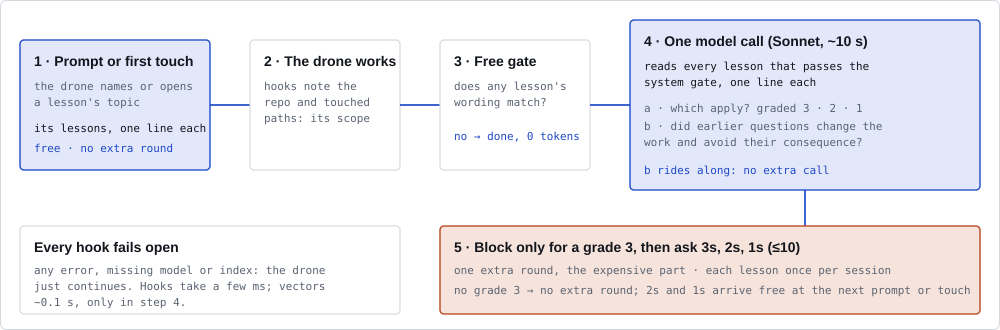

<p align="center"></p>

# Borg

Borg is a shared memory for coding agents. It learns from the corrections engineers give their agents
and brings each lesson back when a later session, yours or a teammate's, meets the same decision. It
runs as hooks in Claude Code and as extensions in omp (oh-my-pi) and opencode. Teams share lessons peer
to peer, with no server.

**Status:** 0.1.0, early. One engineer has used it on one machine. Read
[Evidence and limits](#evidence-and-limits) before you rely on it.

- [How it works](#how-it-works)
- [Delivery modes](#delivery-modes)
- [Quick start](#quick-start)
- [Daily use](#daily-use)
- [Cost](#cost)
- [Privacy](#privacy)
- [Evidence and limits](#evidence-and-limits)
- [Upgrade and uninstall](#upgrade-and-uninstall)
- [Development](#development)

Reference: [Configuration](docs/configuration.md) · [Team sync](docs/team-sync.md) ·
[Commands](docs/commands.md) · [Statistics and the live page](docs/statistics.md) · [Reports](reports/)

## How it works

A **drone** is one agent session. A **lesson** is what a correction becomes: a question the agent should
ask itself, the situations where it applies, and the consequence it prevents. A **collective** is one
shared memory for a set of repos and engineers.


**Learning.** Borg records an *episode* when you push back on the agent ("no, use a channel") or reject a
tool call with a reason. At session end, `borg learn` makes one model call per episode and writes a
lesson. A new correction on the same point updates the existing lesson.

**Delivery.** Borg spends tokens only where a lesson is likely to matter:



1. **Early, free.** When a prompt or touched file first names a lesson's topic, Borg adds that topic's
   top lessons to the context. Word matching only. Claude Code only.
2. **Turn end, graded.** A free word gate skips most turns. Otherwise one model call grades every
   eligible lesson: 3 = certain, 2 = likely, 1 = worth a thought. A grade 3 blocks the stop and the agent
   works one more round. Grades 2 and 1 arrive free with the next prompt or touch. In
   [live mode](#delivery-modes) the same call also runs during the turn, after the agent changes something.
3. **Judged by meaning.** The same call checks whether earlier questions changed the agent's work.
4. **System gate.** When the repo maps to a known system, lessons scoped to other systems stay out, even
   if the conversation names them.

**Memory.** Use strengthens a lesson; disuse lets it fade. A lesson unused for about 54 sessions of its
collective goes dormant. Only a strong match wakes it, and nothing is deleted. The clock counts
sessions, not days, so a holiday erases nothing.

<p align="center"></p>

**Reach.** A correction about the code becomes a team lesson. One about how *you* like the agent to
work (commit style, AI attribution, branching) is personal: it goes to your private collective and
never reaches the team. A convention of one repo is delivered only there. See
[Who hears a lesson](docs/configuration.md#who-hears-a-lesson).

**Collectives.** Each repo path belongs to one collective, or to none:

- **team** collectives sync to their members over the [peer mesh](docs/team-sync.md);
- **private** collectives (`"share": "local"`) never leave the machine;
- **off** repos are invisible: Borg returns before it reads or writes anything.

A session reads only its own collective's lessons.

**Also included:**

- `borg why <file>:<line>` shows the redacted reasoning behind a commit, kept as a git note
  (`refs/notes/borg`, never pushed).
- `borg top` lists the drones running across the team; `borg steer` sends them a signed instruction.
- **Expert repos:** a collective can name local checkouts of its dependencies. A turn end that touches
  one gets at most three cited claims from that checkout, at the pinned version.
- **The queen** holds open decisions for the engineer. A drone asks one at the first prompt of a session.
  See [Answering the queen](docs/commands.md#answering-the-queen).

When memory cannot answer, the design escalates. Steps 1, 2 and 4 are built; step 3 is not:


## Delivery modes

Each collective delivers in one of two modes. Both use the same lessons, the same graded model call and
the same questions. They differ in *when* the call runs.

- **hook** (the default): the call runs at the turn end. A lesson that applies mostly arrives after the
  work is done, and a grade 3 costs the agent a redo round.
- **live**: the call also runs *during* the turn, so a lesson can land before a mistake spreads across
  ten edits. It reuses the hook machinery: no daemon, no extra process between turns.

| | hook | live |
|---|---|---|
| Prompt | Early delivery and waiting grade-2/1 lessons, free | The same, plus questions from a live check that finished since |
| Tool call | Early delivery, free | The same. After a state-changing call (an edit, or a shell command that is not read-only), a check of the turn so far starts in the background. Its grade-3 lessons arrive with the next tool call as "borg check of your work so far"; the agent answers them as it works. Grades 2 and 1 arrive free, as at the turn end |
| Turn end | The free gate, then one graded call; a grade 3 blocks for one more round | The same backstop. When a live check that started this turn covered every change and nothing changed since, the stop skips its model call. A live check's grade 3 that no tool call delivered yet blocks the stop, as in hook mode. Lessons asked live are not asked again |
| Model calls | At most one per turn end; the gate skips most | One per burst of changes (at most one running at a time, at most one start per 45 s), plus the turn end when changes came after the last check |
| Added latency | None mid-turn; ~10 s at a checked turn end | None: the hook starts the check and returns at once. A stop waits at most 15 s for a check still running |
| Harnesses | Claude Code, omp, opencode | Claude Code (omp and opencode follow) |

**Switch** per collective with `"mode": "live"` in its entry of `collectives.json`, or for one shell with
`BORG_MODE=live` (or `hook`), which overrides the config. `BORG_LIVE_DEBOUNCE_S` sets the least time
between two checks (default 45). An unknown value means hook, and `borg doctor` warns. Switching back
is the same edit; nothing is migrated.

**See what it does:** `borg status` and `borg doctor` print each collective's mode and where it came
from, and `borg status` counts live checks apart from turn-end checks. In `borg web`, the header and the
drone cards show the mode, the Conscience page splits live checks from turn-end checks and what the
questions led to by channel (live check or turn end), and the Cost page shows check cost by mode per day.

A live check still running when the stop gives up waiting (15 s) can finish after the turn ended; its
grade-3 lessons then arrive with the next prompt, or never if the session ends there.

Live mode needs the consequence model. Under `BORG_MATCH=bm25`, `BORG_ONLY` or `BORG_CRITIC` it does
nothing: the drones run in hook mode. `borg doctor` warns and `borg status` notes it on the mode line
(the hook's own stderr note is not shown by the agent). omp and opencode drones of a live collective
run, and count in the statistics, in hook mode.

**Which is better?** Not yet known, so the default stays hook. The decision rule was fixed before the
run: live becomes the default only if, on an internal benchmark of real engineering tasks with graded
outcomes, it passes at least as many criteria as hook (mean difference > 0, 95% CI lower bound ≥ −0.5)
and causes no more redo rounds per run.

## Quick start

**Requirements**

- Rust 1.88 or newer (edition 2024), via [rustup](https://rustup.rs).
- Linux or macOS. Tested on Linux only.
- A harness: [Claude Code](https://docs.anthropic.com/en/docs/claude-code) gets every feature. omp
  (tested with 18.8.5) and opencode get the turn-end check, learning and steering, but no early delivery
  and no live mode yet ([omp](adapters/omp/README.md), [opencode](adapters/opencode/README.md)).
- One logged-in model CLI on `PATH`: `claude`, `omp` or `opencode`. Borg's model steps (learning, the
  turn-end check) run headless through the harness the drone runs in (Sonnet by default for `claude`,
  the configured default model for omp and opencode), and through another installed one if it gives
  no answer. Without any, Borg still records episodes and delivers by word matching, but learns nothing.

**1. Install.**

```sh
git clone https://github.com/debe/borg_ai borg && cd borg
cargo install --path crates/borg --locked        # the CLI and hook binary, vectors included
cargo install --path crates/borg-mesh --locked   # only for team sync, borg top across machines, borg steer
cargo install --path crates/borg-web --locked    # only for borg web, the live page
```

Both land in `~/.cargo/bin`. The hooks call `borg` by absolute path, so keep it there.
`--no-default-features` builds a lean binary without vectors.

**2. Configure collectives.** Do this before you wire the hooks. Without a config, every repo joins one
team collective named `default`, which a mesh would share. A minimal
`~/.config/borg/collectives.json`:

```json
{
  "default": "off",
  "collectives": [
    { "name": "platform-team", "paths": ["~/work"], "share": "team" },
    { "name": "private", "paths": ["~/personal"], "share": "local" }
  ]
}
```

Check the routing with `borg collective ~/work/some-repo`. Rules, the `off` list and engineer aliases are
in [Configuration](docs/configuration.md#collectives).

**3. Wire the hooks.** Every step is a dry run until `--apply`, and each changed file gets a backup.

```sh
borg install all              # dry run: prints the diff for claude, omp and opencode
borg install all --apply
borg doctor                   # checks wiring, config, the claude CLI and the stores
```

**4. Import what you have (optional).**

```sh
borg assimilate --apply --limit 50                                  # corrections from past sessions
borg assimilate --from-dir ~/work/handbook --plan /tmp/plan.json    # team documents: writes a plan (model calls)
borg assimilate --from-dir ~/work/handbook --apply --plan /tmp/plan.json
borg vectors --fetch && borg vectors --rebuild                      # ~490 MB model, better recall on paraphrases and German
```

Details: [Import](docs/configuration.md#import-what-you-already-have),
[Vectors](docs/configuration.md#vectors). For a team, continue with [Team sync](docs/team-sync.md).

## Daily use

Borg runs on its own. These commands show what it does:

| Command | Shows or does |
|---|---|
| `borg status` | Each collective's mode, lessons, episodes and outcomes, and what is wired |
| `borg doctor` | What is broken: config, hooks, adapters, the `claude` CLI |
| `borg collective [DIR]` | Which collective a directory belongs to |
| `borg queen` | Open decisions waiting for you; `borg queen ask` answers them one by one |
| `borg top` · `borg steer` | Running drones across the team; send them a signed instruction |
| `borg why <path>:<line>` | The reasoning behind a line of code |
| `borg web` | A live page of the knowledge and what the collective did, on 127.0.0.1 |

All commands: [Commands](docs/commands.md). Every switch: [Environment variables](docs/configuration.md#environment-variables).

## Cost

- **Most turn ends cost 0 tokens** (hook mode). The free gate skipped 78% of real turn ends. Early
  delivery and grade-2 and grade-1 lessons never call a model.
- **A turn-end call** costs about $0.07 (Sonnet, mean over 67 calls) and takes about 10 s.
- **An extra round** happens only for a grade-3 lesson at the turn end, billed by your harness as normal
  agent work.
- **Live mode** adds one call of the same kind per burst of changes during the turn, in the background.
  The turn end then skips its own call when a live check covered every change. Questions asked live
  cost no extra round. There is no cost cap: `borg status` and the Cost page show what each mode spent.
  Real-session cost per turn is not measured yet.
- **Learning** costs about $0.02 per correction (21 lessons from 10 sessions: $0.66).
- `assimilate --from-dir` makes one call per document chunk and prints each call's cost.

## Privacy

**Stays on your machine:** everything from off repos and private collectives; raw episodes (your exact
corrections), transcripts, source code, `collectives.json`, per-session state.

**Goes to team members,** for team collectives only:

- lessons: question, situations, consequence, scope, author emails, repo names;
- reasoning excerpts of landed commits, redacted, each held by two members;
- presence for `borg top`: session, harness, email, repo, first line of your latest prompt (redacted),
  recently touched paths;
- steering instructions and the signed member list;
- daily usage counts per engineer: checks, questions, outcomes, corrections, cost, lesson ids
  ([Statistics](docs/statistics.md#privacy)).

**A mesh relay** sees node ids, IP addresses and traffic volume, never content. Run your own relay to
keep even that in-house; see [Privacy on the mesh](docs/team-sync.md#privacy-on-the-mesh).

**The model provider** receives what each model step needs: the turn and the eligible lessons, or the
episode being learned.

Redaction (`redact` in `crates/borg/src/notes.rs`) strips tokens, keys, passwords and `.env` values from
excerpts and presence. Lessons skip it: the model writes them as general questions, but read
`lessons.jsonl` before you share a collective that handled secrets.

**Hooks fail open.** A missing binary, a crash, an invalid config, an unreachable model or a locked index
lets the agent continue untouched. The turn-end call stops after 45 s; if it fails, the turn ends without
questions. A live check that fails asks nothing, and the turn end checks as in hook mode. Unlearned
episodes wait for the next run.

## Evidence and limits

Each change to the defaults was tested against a rule written before the paid run. Most tests used the
author's sessions, so their data is not in this repository.

| Experiment | Result |
|---|---|
| Lessons at the turn end, 15 real decisions, sealed sandbox | engineer points raised 34% → 63% (significant) |
| Graded turn end vs. the earlier shortlist | relevant lessons reaching the agent 45% → 64% (+0.17 [+0.09, +0.25]); extra rounds with nothing relevant 8 → 3 of 16 |
| What a memory keeps, 10 real sessions | Borg 21 of 21 lessons useful (95% CI 84.5–100%); Hindsight 169 of 543 items |
| Against Hindsight, same memory model | accuracy tied; with Sonnet-built lessons, +29 points on lesson cases (significant) |
| Team documents condensed into lessons | +1.7 knowledge checks per run over a plain agent; level with the hand-written skill |
| System gate, real cross-system session | wrong-system deliveries 83 → 0; no relevant lesson lost |
| Free gate, 1,117 real turn ends | 78% skipped at 0 tokens |
| Vectors | shortlist recall +0.09, +0.14 on German work, ~120 ms |
| Public data ([SWE-chat](reports/swe-chat.md)), 150 corrections in 15 strangers' repos | no memory helped, Borg included; only ~3% of corrections repeat an earlier one |
| End-to-end run in a sandboxed home ([dogfood](reports/dogfood-e2e.md)) | all 18 plumbing checks pass; no measurable gain on that task |
| Live vs hook mode, internal task benchmark | not run yet; the rule that decides the default is fixed |

**Known limits:**

- One engineer, one machine. No team has used the mesh in daily work, and real NAT traversal is
  untested.
- Small samples (16 negative and 51 positive turn-end cases; 10 sessions for memory quality). The
  intervals are wide.
- Turn-end asking of the engineer (`BORG_QUEEN=on`) failed its test and is off.
- omp and opencode get lessons only at the turn end, and live mode is Claude Code only.
- Borg learns only from corrections. Knowledge nobody corrected enters only through
  `assimilate --from-dir`.

## Upgrade and uninstall

```sh
git pull
cargo install --path crates/borg --locked --force
cargo install --path crates/borg-mesh --locked --force   # if installed
borg install all              # dry run: shows adapter changes for omp and opencode
borg install all --apply      # only if the dry run shows a diff
borg doctor
```

Claude Code hooks call the binary by path, so a reinstall needs no rewiring. Stores are append-only
JSONL and need no migration.

```sh
borg uninstall all --apply    # removes only what install added; keeps a backup
cargo uninstall borg borg-mesh
```

Uninstall leaves an edited adapter copy in place and reports it. Your data stays too: delete
`~/.local/share/borg` and `~/.config/borg` to remove it, and `git update-ref -d refs/notes/borg` in each
repo for the reasoning notes.

## Development

```sh
scripts/check.sh                              # everything below; run before a release
cargo test --workspace
cargo test -p borg --no-default-features      # the lean build
cargo clippy --workspace --all-targets -- -D warnings
cargo fmt --all                               # max_width 160
node --test adapters/omp/borg.test.ts         # adapter tests; need target/debug/borg and Node 23.6+ or bun
node --test adapters/opencode/borg.test.ts
python3 scripts/figures.py                    # regenerates the figures in docs/img
```

| Path | What |
|---|---|
| `crates/borg` | The product: CLI, hooks, learning, turn-end check, memory, collectives, install, vectors |
| `crates/borg-mesh` | Peer sync, membership, presence, steering (iroh); separate so the hook binary stays small |
| `crates/borg-trace` | Parses Claude Code and omp transcripts |
| `crates/borg-eval`, `crates/borg-search`, `eval/` | Eval harness and benchmarks; not shipped, use local paths under `~/.local/share/borg/eval/` |
| `adapters/omp`, `adapters/opencode` | TypeScript adapters, compiled into `borg` |
| `reports/` | Measured results |

License: MIT OR Apache-2.0 ([LICENSE-MIT](LICENSE-MIT), [LICENSE-APACHE](LICENSE-APACHE)).
