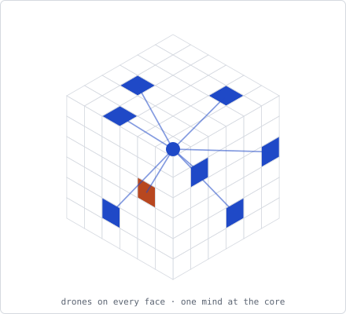
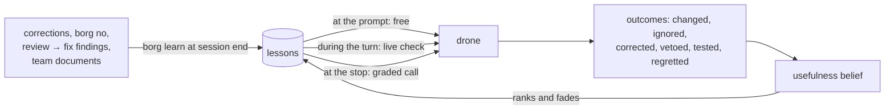
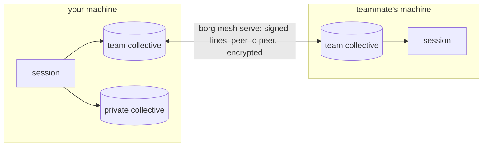
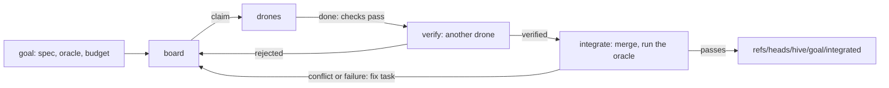

<p align="center"></p>

# Borg

Borg is a shared memory for coding agents. It turns the corrections you give your agent, and your team's
written knowledge, into short lessons, and brings each lesson back when a later session, yours or a
teammate's, meets the same decision. It runs as hooks in Claude Code and Codex and as extensions in omp
(oh-my-pi) and opencode, learns in one plain session with nothing else running, and shares lessons with a
team peer to peer, with no server.

**Status:** 0.1.0. In daily use, with lessons syncing between engineers' machines over the mesh, across
NATs. Tested on Linux and macOS. Read [Evidence and limits](#evidence-and-limits) before you rely on it.

- [Quick start](#quick-start)
- [How it works in one session](#how-it-works-in-one-session)
- [The team](#the-team)
- [The hive](#the-hive)
- [Monitoring](#monitoring)
- [Cost](#cost)
- [Privacy](#privacy)
- [Evidence and limits](#evidence-and-limits)
- [Upgrade and uninstall](#upgrade-and-uninstall)
- [Development](#development)

Reference: [How one session learns](https://github.com/debe/borg_ai/blob/main/docs/learning.md) · [Delivery and modes](https://github.com/debe/borg_ai/blob/main/docs/delivery.md) ·
[Commands](https://github.com/debe/borg_ai/blob/main/docs/commands.md) · [Configuration](https://github.com/debe/borg_ai/blob/main/docs/configuration.md) · [Team sync](https://github.com/debe/borg_ai/blob/main/docs/team-sync.md) ·
[Statistics and the page](https://github.com/debe/borg_ai/blob/main/docs/statistics.md) · [Harnesses](https://github.com/debe/borg_ai/blob/main/docs/harnesses.md) · [Own relay](https://github.com/debe/borg_ai/blob/main/docs/relay.md) ·
[Evidence](https://github.com/debe/borg_ai/blob/main/docs/evidence.md) · [Reports](https://github.com/debe/borg_ai/tree/main/reports)

## Quick start

```sh
curl -fsSL https://raw.githubusercontent.com/debe/borg_ai/main/scripts/install.sh | sh
```

This installs prebuilt, sha256-checked `borg`, `borg-mesh` and `borg-web` into `~/.local/bin` (Linux
x86_64/arm64, macOS on Apple silicon) and runs `borg setup`. Setup asks which harnesses to wire, which
repos go to a private or team collective and which stay `off`, fetches the vector model (~490 MB, once),
optionally learns the 50 newest corrections from your past sessions, shows every change, writes nothing
until you confirm, and ends with `borg doctor`. A second run changes nothing. Then start your agent as
usual:

| Harness | After setup | Notes |
|---|---|---|
| Claude Code | `claude` | Every feature. Hooks in `~/.claude/settings.json` |
| omp 18.8.5, 18.10.4 | `omp` | Live mode needs omp 18.4.4 or newer. [adapters/omp](https://github.com/debe/borg_ai/blob/main/adapters/omp/README.md) |
| opencode 1.18.32, 1.19.0, 2.0.23, 2.0.29 | `opencode` | [adapters/opencode](https://github.com/debe/borg_ai/blob/main/adapters/opencode/README.md) |
| Codex CLI 0.153.2 | `codex`, then `/hooks` once to trust borg's hooks | Hooks in `~/.codex/hooks.json`; `borg doctor` says when codex skips them. Borg's own model calls need `claude`, `omp` or `opencode` on `PATH`, or `BORG_PREDICT_MODEL=codex:<model>` and `BORG_LEARN_MODEL=codex:<model>`. [adapters/codex](https://github.com/debe/borg_ai/blob/main/adapters/codex/README.md) |

Borg's model steps (learning, the checks) run headless through a logged-in CLI on `PATH`, the drone's
own harness first (Sonnet by default for `claude`). Without one, Borg still records episodes and delivers
by word matching, but learns nothing.

**Other ways in.** `install.sh` takes `--version`, `--dir` and `--no-setup` after `sh -s --`. From
crates.io: `cargo install borg-ai --locked` (plus `borg-mesh` for a team, `borg-web` for the page; Rust
1.91+; `--no-default-features` builds a lean `borg` without vectors). Setup flags answer its questions for
scripts:

```sh
borg setup --yes --private ~/src                              # no questions; defaults for the rest
borg setup --team platform --paths ~/work --relay disabled    # found a team collective
borg setup --join BORG1... --paths ~/work                     # join one with a ticket
borg setup --no-vectors --harness claude,codex
```

By hand: write `~/.config/borg/collectives.json` ([Collectives](https://github.com/debe/borg_ai/blob/main/docs/configuration.md#collectives); without
one every repo joins a team collective named `default`), then `borg install all` (a dry run) and
`borg install all --apply`, `borg vectors --fetch`, and optionally `borg assimilate --apply --limit 50`.
Intel Macs, the macOS C++ header workaround and source builds: [Install](https://github.com/debe/borg_ai/blob/main/docs/configuration.md#install).

## How it works in one session

A **drone** is one agent session. A **lesson** is what a correction becomes: a question the agent should
ask itself, the situations where it applies, and the consequence it prevents. A **collective** is one
memory for a set of repos. Everything in this section works in one plain interactive session, with no
team and no hive.



**Learning.** Borg records an *episode* when you push back ("no, use a channel") or reject a tool call
with a reason. At session end `borg learn` makes one model call per episode and writes or updates a
lesson. Team documents become lessons through `borg assimilate --from-dir`.
[Sources of lessons](https://github.com/debe/borg_ai/blob/main/docs/learning.md#sources-of-lessons)

**Delivery.** Lessons arrive at three moments. *At the prompt or a touched file*, free, by word matching
(Claude Code; ratified constraints on every harness). *During the turn*, in live mode (the default): after
an edit a background check grades the work so far and its questions arrive with the next tool call. *At
the stop*, a free word gate skips most turns; otherwise one model call grades the eligible lessons, and a
grade 3 blocks the stop for one more round. The same call judges whether what was handed over earlier
changed the work. `"mode": "hook"` checks only at the stop. [Delivery and modes](https://github.com/debe/borg_ai/blob/main/docs/delivery.md)

**Outcomes and belief.** Every delivery is logged with its probability, and what followed (changed,
ignored, corrected anyway, vetoed, regretted, tested) moves the lesson's usefulness belief. `borg memory`
shows it; `borg ope` replays the weights offline. [Outcomes](https://github.com/debe/borg_ai/blob/main/docs/learning.md#outcomes-and-the-usefulness-belief)

**Review → fix.** A reviewer sub-agent finds a bug and a fix step fixes it before any commit. `borg
review-fix` reads those runs from Claude Code, omp, opencode and Codex at 0 tokens, and each fixed finding
becomes a lesson for the moment of building. On by default. [Review → fix](https://github.com/debe/borg_ai/blob/main/docs/configuration.md#review--fix-findings)

**Regret.** A later commit that fixes an earlier decision is linked to it (`borg why` shows both ends).
With `BORG_REGRESS=learn` the fix becomes a lesson for the decision point; links only, by default. A
regret also counts against the lessons asked before the decision. [Decision → fix links](https://github.com/debe/borg_ai/blob/main/docs/configuration.md#decision--fix-links)

**Green tests.** When a lesson was asked and the session's own tests then went from red to green, or
passed after the drone changed its work on the point, the lesson gets a `tested` credit at 0 tokens.
[Green tests](https://github.com/debe/borg_ai/blob/main/docs/learning.md#outcomes-and-the-usefulness-belief)

**`borg no <reason>`** (or a prompt starting "borg no") vetoes what the drone is doing, at 0 tokens: the
lessons it was shown lose credit, the reason becomes a lesson, and an invariant in it is proposed as a
constraint you can ratify. [Saying no](https://github.com/debe/borg_ai/blob/main/docs/learning.md#saying-no)

**Memory.** Use strengthens a lesson, disuse fades it: about 54 sessions without use make it dormant,
never deleted. The clock counts sessions, not days. [Memory](https://github.com/debe/borg_ai/blob/main/docs/learning.md#memory)

**The queen** holds decisions no lesson answers (open decisions from documents, proposed constraints,
playbook edits). The drone asks you one at a session's first prompt, the session's own before any hive
question; `borg queen` lists them. Playbooks, the team's steps for a kind of task, are also learned from
plain sessions that end clean. [The queen](https://github.com/debe/borg_ai/blob/main/docs/learning.md#the-queen) ·
[Playbooks](https://github.com/debe/borg_ai/blob/main/docs/commands.md#playbooks)

## The team

Each repo belongs to one collective: **team** (synced to its members), **private** (`"share": "local"`,
never leaves the machine) or **off** (Borg reads and writes nothing). A correction about the code becomes
a team lesson; one about how *you* like the agent to work goes to your private collective; a repo
convention is delivered only in its repo. [Who hears a lesson](https://github.com/debe/borg_ai/blob/main/docs/configuration.md#who-hears-a-lesson)



Each machine runs `borg mesh serve`. Peers find each other by key over iroh, through NAT or a relay, and
reconcile append-only files by hash. Hooks only read and write local files, so nothing waits on the mesh.
What syncs and what stays is under [Privacy](#privacy). `borg top` lists the team's running drones;
`borg steer` sends them a signed instruction. Set up: `borg setup --team` or `--join`, or
[Team sync](https://github.com/debe/borg_ai/blob/main/docs/team-sync.md); for a company, [Company collective](https://github.com/debe/borg_ai/blob/main/docs/team-sync.md#company-collective).

## The hive

A hive is many drones on one goal: a board of tasks, each claimed with a lease, finished only when its
checks pass, verified by another drone, and merged into one combined tree that must pass the goal's
oracle. Built as preparation: it works, and no value metric has been shown yet.



**Drones are interactive sessions you open.** Built: `borg hive init` makes a goal; a session started with
`BORG_HIVE=<goal>`, joined with `borg hive join <goal>`, or started in a repo marked with
`borg hive join <goal> --here` gets the board at its prompt, claims a task and has its stop gated on the
task's checks; `borg hive integrate <goal>` merges the verified work. In a team collective the board,
contracts, messages and spend sync, so drones on several machines share one board and one budget (proven
on two loopback nodes). Verdicts, reworks and groups of attempts credit and teach lessons like any
outcome. Tell any session what to build: its borg skill opens the goal (small tasks, contracts first,
a check per task) and asks you to approve the plan at your own prompt (`yes`, or `no, because ...`);
no drone takes a task before your yes, and the session then says how many drones wait. A goal you open
from a terminal is approved with `borg hive ratify <goal>`. Claude Code drones' claims are metered
from their transcripts, and new claims stop at the goal's budget until you raise it. Coming: a
measured run across real machines. `borg hive run --drones N` runs headless drones in
worktrees; it is what the evals use. A session that never joins a goal sees no change.
[Hive commands](https://github.com/debe/borg_ai/blob/main/docs/commands.md#hive) · [Design and status](https://github.com/debe/borg_ai/blob/main/docs/design/hive.md)

## Monitoring

```sh
borg web        # http://127.0.0.1:7979/, the collective of the current directory first
```

A live page on 127.0.0.1 with tabs for the Overview, Knowledge (every lesson, its belief and state),
Conscience (checks, questions and what they led to per channel), Drones, the Queen (open questions, the
queen's attention score), Learning (week by week: lessons per source, the share of asked lessons that
changed the work, repeated vetoes, hive mistakes caught, playbook versions), Hive (each goal's tasks over time, its nodes, and its interactive drones: working,
busy, waiting or gone, with their wake latency) and Cost. It reads the
same files as `borg top` and needs no mesh. In the terminal: `borg status` (modes, stores, what is wired,
spend), `borg doctor` (what is broken), `borg memory`, `borg queen`, `borg top`.
[Statistics and the page](https://github.com/debe/borg_ai/blob/main/docs/statistics.md)

## Cost

- **Most turn ends cost 0 tokens** in hook mode: the free gate skipped 78% of 1,117 real turn ends. Early delivery
  and grade-2 and grade-1 lessons never call a model; they are judged only inside a call a question pays
  for.
- **A turn-end call** costs about $0.07 (Sonnet, mean over 67 calls) and takes about 10 s. An extra round
  happens only for a grade-3 lesson.
- **Live mode** adds one call per burst of changes: on the benchmark, borg's side cost $0.56 per task in
  live mode and $0.07 in hook mode, while whole runs cost about the same ($5.05 vs $4.97).
- **Learning** costs about $0.02 per correction (21 lessons from 10 sessions: $0.66). `assimilate --from-dir` makes one call per chunk and
  prints its cost. `borg no`, review → fix, regrets and green tests cost 0 tokens.
- There is no cost cap: `borg status` and the Cost tab show what each mode spent.

## Privacy

**Stays on your machine:** everything from off repos and private collectives; raw episodes (your exact
corrections), transcripts, the shell output adapters hand to borg, source code, `collectives.json`,
per-session state.

**Goes to team members,** for team collectives only, each line signed and dropped on revocation:
lessons (with author emails and repo names); redacted reasoning excerpts of landed commits, each held by
two members; decision → fix links; presence for `borg top` (harness, email, repo, the redacted first line
of your latest prompt, touched paths); steering and the signed member list; daily usage counts per
engineer; outcomes with session, repo and regret hashed (`BORG_SHARE_OUTCOMES=off` keeps them local);
ratified constraints (the invariant, its lesson and who ratified it, never the veto's words); promoted
playbook edits; and hive goals with their boards, contracts, messages, guard flags, spend and commit bundles (task
text redacted; hidden checks stay local).

**A mesh relay** sees node ids, IP addresses and traffic volume, never content; run your own to keep even
that in-house ([Privacy on the mesh](https://github.com/debe/borg_ai/blob/main/docs/team-sync.md#privacy-on-the-mesh), [Own relay](https://github.com/debe/borg_ai/blob/main/docs/relay.md)).
**The model provider** receives what each model step needs: the turn and the eligible lessons, or the
episode being learned.

Redaction (`redact` in `crates/borg/src/notes.rs`) strips tokens, keys, passwords and `.env` values from
excerpts, presence and hive text. Lessons skip it: the model writes them as general questions, but read
`lessons.jsonl` before you share a collective that handled secrets.

**Hooks fail open.** A missing binary, a crash, an invalid config, an unreachable model or a locked index
lets the agent continue untouched. A turn-end call that fails ends the turn without questions, a live
check that fails asks nothing (the turn end then checks as in hook mode), and unlearned episodes wait for
the next run. [Time limits](https://github.com/debe/borg_ai/blob/main/docs/delivery.md#delivery-modes)

## Evidence and limits

**Shown, against rules written before each paid run** (mostly on the author's and a few colleagues'
sessions, so the data is not here):

- lessons at the turn end raised engineer points from 34% to 63% on 15 real decisions in a sealed sandbox;
- a memory of 21 lessons from 10 sessions held 21 useful ones; accuracy tied with Hindsight on the same
  memory model;
- team documents as lessons: +1.7 knowledge checks per run, level with a hand-written skill;
- the system gate cut wrong-system deliveries from 83 to 0;
- live mode: not worse than hook, sometimes better (+0.38 criteria per task [0, +0.88], 0 redo rounds);
- review → fix lessons: +6 points of later bugs avoided [−5.1, +18], on by default although the lower
  bound misses its pre-set −5 by 0.1;
- the hive finished every board and passed every held-out check in 6 acceptance runs.

**Not shown:** that Borg helps strangers on public data (SWE-chat: no memory helped, Borg included);
decision → fix precision on real history (so `BORG_REGRESS` stays `links`); whether the regret credit
improves the belief (the check was inconclusive: no data yet); the weights of vetoes and green tests;
whether a hive beats one session with subagents; the hive across real machines. omp, opencode and Codex
get no early delivery of ordinary lessons, and there a live check sees tool calls, not prose.
Full table, the regret check and every known limit: [Evidence and limits](https://github.com/debe/borg_ai/blob/main/docs/evidence.md).

## Upgrade and uninstall

```sh
cargo install borg-ai --locked --force       # or install.sh again
cargo install borg-mesh --locked --force     # if installed
borg install all              # dry run: shows adapter, hook and skill changes
borg install all --apply      # only if the dry run shows a diff
borg doctor
```

Hooks call the binary by path, so a reinstall needs no rewiring. Codex trusts each hook's command and
timeout: after an upgrade that moves borg or changes a timeout, trust them again with `/hooks`
(`borg doctor` says so). Stores are append-only JSONL and need no migration. A team must upgrade
together when the mesh protocol changes (now `borg/mesh/12`): nothing syncs with a member on another
version, and `borg doctor` names that member and which side has to upgrade.

```sh
borg uninstall all --apply    # removes only what install added; keeps a backup
cargo uninstall borg-ai borg-mesh borg-web    # or delete them from ~/.local/bin after install.sh
```

Uninstall leaves an edited adapter or skill file in place and reports it. Your data stays: delete
`~/.local/share/borg` and `~/.config/borg` to remove it, and `git update-ref -d refs/notes/borg` in each
repo for the reasoning notes.

## Development

```sh
scripts/check.sh                              # everything below; run before a release
cargo test --workspace
cargo test -p borg-ai --no-default-features   # the lean build
cargo clippy --workspace --all-targets -- -D warnings
cargo fmt --all                               # max_width 160
node --test adapters/omp/borg.test.ts         # adapter tests; need target/debug/borg and Node 23.6+ or bun
node --test adapters/opencode/borg.test.ts
node --test adapters/conformance/conformance.test.ts   # harness conformance (docs/harnesses.md)
scripts/arch.sh                               # the harness abstraction's metrics and gates
python3 scripts/figures.py                    # regenerates the figures in docs/img
```

| Path | What |
|---|---|
| `crates/borg` | The product (crate `borg-ai`, binary and library `borg`): CLI, hooks, learning, checks, memory, collectives, hive, install, vectors. `assets/` holds the skill and the TS adapters it compiles in |
| `crates/borg-mesh` | Peer sync, membership, presence, steering (iroh); separate so the hook binary stays small |
| `crates/borg-trace` | Parses Claude Code and omp transcripts |
| `crates/borg-web` | `borg web`, the live page; `dist/` is its built Leptos client (`ui/`), committed |
| `crates/borg-eval`, `crates/borg-search`, `eval/` | Eval harness and benchmarks; not shipped, use local paths under `~/.local/share/borg/eval/` |
| `adapters/omp`, `adapters/opencode` | TypeScript adapters, compiled into `borg` (`borg.ts` links to `crates/borg/assets/adapters/`) |
| `adapters/codex` | How the Codex hooks are wired and what they miss |
| `adapters/conformance` | The harness conformance suite ([Harnesses](https://github.com/debe/borg_ai/blob/main/docs/harnesses.md): one module per agent behind one trait) |
| `skills/borg` | The `borg` skill `borg install` copies into each harness (a link to `crates/borg/assets/skills/borg`) |
| `reports/` | Measured results |

Contributing: [CONTRIBUTING.md](https://github.com/debe/borg_ai/blob/main/CONTRIBUTING.md). Security reports: [SECURITY.md](https://github.com/debe/borg_ai/blob/main/SECURITY.md).
License: MIT OR Apache-2.0 ([LICENSE-MIT](https://github.com/debe/borg_ai/blob/main/LICENSE-MIT), [LICENSE-APACHE](https://github.com/debe/borg_ai/blob/main/LICENSE-APACHE)).
