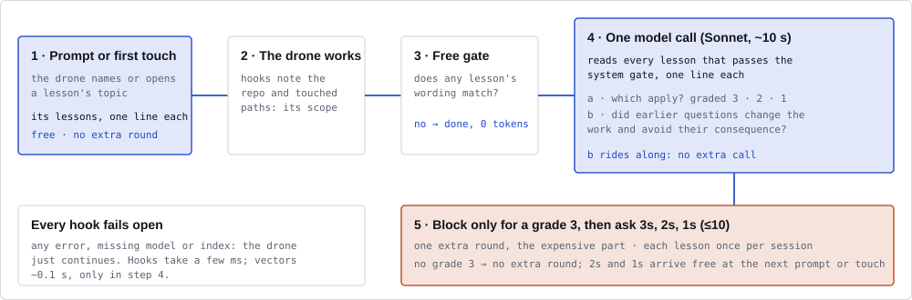

# Delivery

[← README](../README.md)

Borg spends tokens only where a lesson is likely to matter.

- [When a lesson arrives](#when-a-lesson-arrives)
- [Which lessons are asked](#which-lessons-are-asked)
- [Context and time limits](#context-and-time-limits)
- [Live mode (removed in 0.7.6)](#live-mode-removed-in-076)

## When a lesson arrives

1. **Early, free.** When a prompt or touched file first names a lesson's topic, Borg adds that topic's
   top lessons to the context, by word matching only, on Claude Code only so far: omp, opencode and Codex
   could take it, but it waits for an evaluation there. Standing lessons
   (ratified constraints, see [Saying no](learning.md#saying-no)) are no ranking guess: they arrive early
   on every harness that takes the context, once their scope is named, an unscoped one at the first
   prompt. `BORG_EARLY=off` turns early delivery off.
2. **Turn end, graded.** A free word gate (`BORG_PREFILTER`) skips most turns. Otherwise one model call
   grades every eligible lesson: 3 = certain, 2 = likely, 1 = worth a thought. The selection policy then
   gives each graded lesson a route: asked, handed over free with the next prompt or touch, or left for
   later. The fixed rule decides as 0.5.0 did: a grade 3 is asked, and grades 2 and 1 alone arrive free
   ([Which lessons are asked](#which-lessons-are-asked)). Nothing checks the work during the turn: live
   mode, which did, was removed in 0.7.6 ([why](#live-mode-removed-in-076)).

   **Detached (0.7.7, the default).** The stop never waits for the model. It runs the free gate, writes
   the turn to a job file in the session's state (the state file's length at the stop, the agent's
   message, where it worked: a file, never arguments), starts `borg check --job <file>` in its own
   session with no input or output, and returns without a block. The check reads the turn up to the
   stop, so the next prompt's lines never reach what it judges. It calls the model holding no lock and
   takes the session lock only to write its answer. Its questions wait for the next prompt or tool call,
   which shows them as questions about the turn they judged (its message's first 160 characters), and
   the agent may skip one the work since then already settled; a session that listens (`borg listen`)
   is woken with them while idle ([Talking to other sessions](../README.md#talking-to-other-sessions)).
   Their channel is `live`: asked, delivered later, no extra round.
   - **One check per session.** A stop while a check runs leaves its job waiting, replacing an older
     waiting one, which never runs (`check_dropped`, why `superseded`); the running check takes the
     newest when it is done. A waiting job it cannot read (another borg's format) is removed and
     counted (`check_dropped`, why `unplaced`).
   - **A newer check settles an older question.** A check grades the questions still waiting again:
     one it asks again replaces the waiting one (route `superseded`: the newer ask's delivery counts),
     one it grades lower or no longer applies is dropped as settled by later work (`dropped_done`). Each
     is a `delivery` record with its reason. While a check runs, no wake carries a waiting question.
   - **The session ended.** A check whose session ended during its call queues nothing; its record
     and each route's `delivery` record say so. A check that never ran logs `check_dropped`, why `gone`.
   - **Leftovers.** A check removes its job file when it exits; a later stop, and `borg learn` for an
     idle session, removes those of a check that died. Nothing else is left: no log, no lock.
   - **Time limit.** The call may take the larger of `BORG_PREDICT_TIMEOUT_S` (45 s) and twice the
     95th percentile of the same model's last 64 answered checks (set, `BORG_PREDICT_TIMEOUT_S` is the
     limit as given). No hook waits for it: it bounds a hung call, never a slow answer. `borg status`
     shows the limit now, the checks that reached it, those superseded or too late, and the largest
     peak memory (`turn check`).

   `BORG_ASYNC=off` keeps the stop's own check: it takes the session lock, calls the model within the
   harness's stop budget, and a grade 3 blocks the stop for one more round.
3. **Judged by meaning.** The same call checks whether what was handed over earlier changed the agent's
   work: questions it asked, and free deliveries (early and queued), each recorded with its channel, the
   check that routed it and its probability of that route. The verdict is one of `changed`, `ignored`,
   `not_arisen` (the point never came up), `consequence_remains` (changed, but the consequence still
   follows) or `unclear`, with a short reason; `changed` and `ignored` settle the delivery, the others
   leave it for another try: a point that has not come up by a check may still come up later, so only
   the session-end judge's `not_arisen` settles ([what each means for a lesson](learning.md#outcomes-and-the-usefulness-belief)).
   Every route gets the same evidence (the work before the delivery and after it); a random half of the
   questions are judged without the agent's own `applies`/`skip` line, so its effect on the judge is
   measured. Questions keep their judge slots first (at most 10 wait).

   **When.** Every delivery is judged at a turn end, after the agent did the work: a question at the
   next stop's call, which sees the answer, a free delivery (early or queued) and a placebo likewise
   (0.7.5 moved them there: a live check's call came a median 0.5-0.8 minutes after the delivery, and
   most of its verdicts on them were unclear). A lesson asked after it was handed over is judged on the
   question, not on the hand-over. A stop's judge call judges every open delivery; a stop that makes
   none (the gate skipped it, or only free deliveries wait) leaves them to a later stop, and free
   deliveries alone never pay for a check's call.

   **Session end.** `borg learn --session` judges once more before it learns: every delivery of the
   session, on any channel, that no verdict settled yet (none came, or only `unclear`,
   `consequence_remains` or missing ones, whatever its tries), with the session's work in view: the
   prompts and touches, the edits and answers, and the agent's messages where its transcript has them
   (Claude Code's). Every open delivery is judged (0.7.6; 0.7.5 saw at most 40): the lessons go in
   batches by delivery order, each batch one call whose whole prompt stays within the judge's budget,
   the lessons taking at most half of it and the work the rest. The budget is the judge's measured
   effective length (below), 72,000 characters until evidence moves it. A session whose work fits is
   read whole in every batch; a longer one is cut per batch by `BORG_END_WORK`: `ends` (the default,
   picked by the 0.7.6 backtest) reads half right after the batch's earliest delivery and half the
   session's end, `after` from that delivery on, `newest` the session's end (0.7.5's); the agent's messages always keep
   their newest part. The batches' calls run four at a
   time under the session's lock, which a stop also holds while it checks. Free deliveries and
   placebos that no stop's call judged are judged here. Its verdicts are recorded as a
   check's are, marked `at: end`, and a lesson it judged is not judged again unless it is delivered
   again; each batch records as soon as its call returns; a failed batch leaves its own lessons open
   (`why=failed`). A second pass of the same session (a resumed session that ends again) waits while
   the first holds the lock, and `borg learn` settles no session whose lock another pass holds. A stop
   that finds the pass holding the lock does not wait: it checks and asks, but judges nothing and asks
   no lesson whose delivery is still open, which the pass is judging. A
   session whose end hook never ran
   gets the same pass when a later `borg learn` settles it as idle. Cost: one call per batch, on the
   checks' model (`BORG_PREDICT_MODEL`), each counted as a `model_call` with why `judge` and its
   dollars in the statistics. A session with nothing open makes no call; `BORG_LEARN=off` or
   `BORG_PREDICT_MODEL=off` turns it off.

   **The judge's effective length.** How much a model reads well falls with the prompt's length, by
   how much depends on the model and the task ([NoLiMa](https://huggingface.co/papers/2502.05167),
   ICML 2025: a model's effective length is the longest context at which it keeps 85% of its
   short-context score). Borg measures it per judge model on the session-end judge's own task, from
   its cost lines in the store: the answered share, the lessons sent that came back with a verdict
   other than `unclear` (a failed call's lessons count as sent and not answered), per prompt size in
   steps of ×1.5 (…, 48,000, 72,000, 108,000, … characters). A check's judge lines are left out: a
   check judges an unfinished session beside its grading, another task. The reference is the smallest
   steps pooled until they hold 30 lessons sent in 5 calls. A step above it, once it has 5 calls,
   holds when the lower bound of its answered share's 95% Wilson interval is at least 85% of the
   reference's share, fails when the upper bound is below that line, and stays open until its
   evidence decides it. The interval counts the lessons a step's calls are worth, not the lessons
   sent: one call's lessons share one prompt and one answer, so calls that disagree widely count for
   fewer (a design effect). The budget starts at 72,000 characters, moves up while the step above
   holds and down while its own step fails. While the step above is open, one session-end pass in
   five, drawn per pass, uses it; once it failed, one in twenty, so it can still hold again later. Its
   cost lines log the chance (`psi=`) and the draw (`explore=`). Lines from before 0.7.6 count where
   they can: a session end's line gives its prompt's size; one without verdict counts (before 0.7.5)
   counts `resolved` as answered; one without `model=` counts for the default judge. The counts are cached in the store's `state/judge-length.json`,
   rebuilt when a cost file changes. `borg status`, `borg top --json` and borg web's label health show
   the budget per model, the answered share per step with its decision, and what is explored.
   `BORG_END_BUDGET=<chars>` pins the budget for an evaluation.

   A correction merged into a lesson delivered free counts against it. After the session-end judge
   `borg learn` settles the rest: a lesson with no verdict is `asked_not_corrected`, with the reason it
   had none, and counts as unknown, never as ignored. See [Mode and
   channel](statistics.md#what-is-counted).
4. **System gate.** When the repo maps to a known system, lessons scoped to other systems stay out, even
   if the conversation names them ([System map](configuration.md#system-map)).

## Which lessons are asked

A graded check gives each lesson that applies one route: **asked** (in a block at the stop, as a
question with the next tool call during the turn), **free** (context with the next prompt or touch) or
**not now** (it stays eligible for a later check). The selection policy chooses the routes. Its
objective is quality, the mistakes the lessons help avoid; there is no cost cap.

**The fixed rule** is the reference everything else is measured against, and the way back
(`BORG_SELECT=fixed`). With a
grade 3, ask every 3 and 2, and the 1s while the block has fewer than 10 lessons. Without one, hand
over the 2s and then the 1s, at most 10. A lesson the session already had delivered may still be
asked, but never takes a free slot, since delivery would drop it as given before: the next 2 or 1
takes the slot. For a session that had none of them, this is 0.5.0's rule.

**Measured under the fixed rule.** The fixed rule's history asks and hands over by grade alone, so a
learned policy cannot tell from it what not delivering is worth, or what lessons past the pool would
yield. The checks therefore also collect, at no cost to the fixed rule's quality:

- **Placebo.** Of the applies a check delivers neither way (under the fixed rule, those past its 10),
  up to two are judged blindly at the point a free delivery would be, though the agent never sees
  them; the evaluation switches draw none. A lesson the session already had is never drawn. Each
  candidate's chance of the draw, min(1, 2 / candidates), is logged (`psi`). Their "changed" rate is
  the judge's floor: what it calls a change that would have happened anyway. A route's value is its
  lift over not delivering. Placebo results never reach the beliefs, trust, statistics, the team file
  or the offline estimates.
- **Tail sample.** When the pool's budget leaves lessons out (below), up to two of them, drawn
  uniformly, are graded after the pool under every policy, so the yield of the positions past the
  budget is measured.
- **What the session had.** Each graded record names the applies the session already had, or had
  waiting in its queue from another check (`nofree`). The delivery rates leave them out, since a drop
  as given before or queued twice says nothing about whether a lesson the session lacks arrives, and a
  replay decides each check under the same lessons.
- **Early relevance.** An early delivery records each lesson's score as a share of the best on-topic
  match (`rel`), for a learned early rule. Early delivery itself keeps its rule: lessons at half the
  best match, at most 5.

`borg status`, `borg top` and the Conscience page of `borg web` count the placebos drawn and judged and
the tail lessons shown and applied.

**The learned policy** is the default, since its pre-registered checks passed (see *Why the
learned policy is the default*, below). It fits one model of what each route is worth from the
logged outcomes: the chance that a lesson changes the work and avoids its consequence, by grade, rank,
channel, a 3 in the check, route and how many lessons share the route (more questions, or more free
context, may make each one less likely to land), with an effect per session, per lesson and per judge
version. A free lesson's value is weighed by its learned chance of
arriving (a stop's question blocks, so it always arrives); a lesson left for later earns its value at
the check that delivers it, not here.

**It deviates only on evidence.** Each check finds the routes that avoid the most mistakes under the
model's posterior mean, and plays them only when they beat the fixed rule's routes at the 5% quantile
over 512 joint draws of the model; otherwise it keeps the fixed rule's (`evidence` when it deviates).
An effect the outcomes do not pin down keeps a wide posterior, and a wide posterior beats the fixed
rule at no quantile, so no prior decides alone. That matters because the fixed rule's history cannot
identify two effects: how much each further question dilutes the others, and what a lesson not
delivered still changes. The dilution prior assumes none (its mode is 0). A new store, with no
outcomes, decides exactly as the fixed rule. Nothing in this decision is drawn at random, so each
lesson's logged chance of its route is exact: 1 or 0. A lesson the session already had is never handed
over free. A conservative gate keeps the fixed rule's routes unless the policy has room: a deviation
is admitted only while the replayed quality of the policy's checks stays at most 10% of the fixed
rule's own replayed value below the fixed rule, at the 5% quantile. The 10% is the engineer's
tolerance for learning, the collective's `risk` in `collectives.json` when it sets one
([Collectives](configuration.md#collectives)). Exploration is rationed by quality, never by a fixed
rate. A grade 3 at the stop is always asked, and a check with more than 16
lessons that apply takes the fixed rule. It draws its placebos as the fixed rule does, among the
applies it leaves for later.

**The question-count test.** The fixed rule never varies how many lessons a check asks: with a grade
3 it asks every lesson it delivers, without one it asks none and hands the 2s and 1s over. Whether
asking a 2 beats handing it over is therefore the decision its history cannot inform. The learned
policy learned it by a randomised test on the live checks where the evidence kept the fixed rule.
**Since live mode was removed (0.7.6) no check runs the test**: it never ran at the stop (below). Its
draws before 0.7.6 stay in the log and still count toward its readout, which therefore waits until
the test runs again (it would need a stop design of its own, pre-registered first). As it ran:

1. Of the lessons the fixed rule delivers, asked or handed over, take the k that are not grade 3 and
   may go free (not one the session already had). With k = 0 there is nothing to test.
2. Draw s uniformly from 0 to k, seeded by the check, so a replay draws the same s.
3. Ask the first s of them in the fixed rule's order (2s before 1s, then by rank), and hand the rest
   over free. Grade 3s are asked, as the fixed rule asks them.

The fixed rule is one of the draws, s = 0 without a 3 and s = k with one: such a check is the test's
control (`experiment_control`), every other draw an `experiment`. Each s has the chance 1/(k + 1), so
each lesson's logged chance of being asked or handed over (`p`, `pf`) is its exact share of the k + 1
counts, and the graded record logs k and s (`xk`, `xs`).

The test never withholds a lesson. Every lesson the fixed rule delivers is still delivered, asked or
handed over, and every lesson it leaves out stays out: only the route changes, so the right lesson
reaches the agent as often as under the fixed rule (P4c checks it). On a check with a grade 3, the
lessons the test hands over are ones the fixed rule would have asked, so they wait in the queue marked
as handed over in place of questions (an `instead` line). The free delivery carries them whatever its
character bound (2,000 characters), as the questions they replace would have been carried, and what
else waits free keeps that bound without them. When the stop comes before the next prompt or touch,
the stop asks them, as the check's own block would have, recorded as asked at the stop for the
check's hand-over (reason `in place of a hand-over`) and counted on its free route. The evidence rule's
hand-overs of lessons the fixed rule asks wait the same way, as `instead-next` lines carried whatever
the bound; no stop asks those, since the evidence rule valued them as hand-overs. What a draw can cost is the
quality of a delivery: a lesson handed over instead of asked may land less often, and a further
question may dilute the others. The gate charges that risk as it charges any deviation: a draw plays
only when its loss against the fixed rule at the 5% quantile fits what the gate may still risk, else
the check takes the fixed rule (`gate`, its k and drawn s still logged), and a count the gate refuses
counts as the fixed rule's routes in the logged chances. The share the gate may risk is the
collective's `risk` (10% by default); `0` turns the test off. The test never runs at the stop: a
stop's question blocks the turn, and a lesson handed over at the stop arrives only if another prompt
comes. A live question blocks the stop only when its check graded a 3, as that check's block at the
stop would have. A question the test draws on a live check without a 3 never blocks it: if no tool
call delivered it by the stop, it arrives with the next prompt (a `live-next` line in the queue), and it is valued at a hand-over's
arrival rate (`free_live`), since the same events bring it; the live-question rate (`ask_live`) is a
check with a 3's.

`borg status`, `borg top` and the Conscience page of `borg web` show the test: the checks it drew a
count for, of them its controls and those the gate refused, how often each s was drawn, the risk share
in force, and, once due, the readout below. They also count the checks whose routes differ from the
fixed rule's under the current fit, on evidence or by a played draw.

The model is refitted at the end of `borg learn`, which every session end starts, never in a hook. A
hook reads a summary of the outcome log cached beside the lessons (`select-summary.json`, local, never
synced) and folds in only the lines added since. A store's learned checks decide one at a time: a
learned check reloads the summary, decides and writes its record under
`<store>/select-summary.json.lock`, never during its model call, so two checks deciding at once never
both spend the gate's room; the fixed rule and the evaluation switches read no gate and take no lock.
A learned check kept waiting more than 1 s, or whose record cannot reach the log its gate is folded
from (learning off, `BORG_CONSCIENCE` at another store's lessons, a failed append), takes the fixed
rule, and a record it writes says why (`reason`: `lock_busy`, `lock_failed` when the lock cannot be
taken, or `unrecorded`); `borg status`, `borg top` and the Conscience page of `borg web` count those
records per reason, so a guard that binds often shows. A lesson still waiting in the queue to be asked
or handed over is decided already: a later check, the stop included, leaves it out of its pool, and
one that graded it meanwhile never hands it over free.

**Monitor.** Under the learned policy, per session, its value against the fixed rule is estimated
(doubly robust, cross-fitted by session) under a confidence sequence over the sessions. If its bound
shows harm beyond 10% of the fixed rule's value, after at least 10 sessions, the store reverts to the
fixed rule for good: `borg status`, `borg top` and borg web say `REVERTED`, and the mark
(`<store>/select-reverted`) stays until the engineer deletes it. Deleting it lets the policy learn
again, until the monitor trips again.

**The pool.** The model call reads up to 12,000 tokens of lessons (`BORG_STOP_POOL_TOKENS` sets it for
every check), one line each: the question, the consequence and, by default, the engineer's correction
it was learned from (`BORG_LESSON_LINE=a2`; `a1` without it). When the eligible lessons do not all fit,
the check explores, whatever the policy (0.7.7; `BORG_BOUNDARY=off` turns it off):
- the fill order (the shortlist, then word match × weight × trust, then newest first) fills the first
  85% of the budget;
- the **tail sample** then draws as many of the lessons that left out as fit in 15% of the budget at
  their mean size, at least two, uniformly, each at the exact chance k / n;
- the **boundary draw** fills the rest of the budget from the remaining ones, favouring those the fill
  order met first: each draw weighs a lesson by e^(−i/τ) at its place i past the prefix, τ the lessons a
  plain fill of that rest would place, skipping one that no longer fits.

The model sees the prefix in store order, then the boundary's lessons, then the tail's. The check's
record keeps `shown` and `tokens` for the prefix, so the pool's yield by position means what it did;
the draws' tokens are its `xtokens`, logged beside them. The latency fit reads `tokens` alone, the size
a budget is predicted at: the draws grow with the store, not the budget. Each lesson's chance to be
shown is logged with the pool (the chance of the boundary draw estimated from 512 seeded replays of both
draws), so the yield past the budget is measured without bias ([The pool log](learning.md#the-pool-log)).
The session's `.cost` file reads `tail=<n> boundary=<n>` on the pool line. Under
the fixed rule the budget stays 12,000 tokens. Under the learned policy, once its gate is open or an
engineer set a budget, the pool may shrink where the yield of its last fill positions buys nothing,
and it grows past 12,000 only on a gain above 0, with the tail sample's yield of the positions it
would add, and with a latency that fits the harness's stop budget measured at that size (20 calls that
read at least 90% of it).

**Cost.** Spend is measured and shown, never capped: calls, extra rounds and dollars per session for
the stop checks (and live checks, before 0.7.6), in `borg status`, `borg top`, `borg debug select` and the Conscience page of
`borg web`. Only an engineer who sets a `budget` for a collective
([Collectives](configuration.md#collectives)) puts a price on it: the pool tokens its checks may read
per session on average. The learned policy then weighs a larger pool against the smallest price that
keeps the replayed spend within the budget, from the first fit that knows the budget, gate open or
not. The fixed rule reads no budget.

**Why the learned policy is the default.** The learned policy's checks were written before it was built
(P0–P5, `borg debug select --replay`, 0 tokens): that a closed gate decides exactly as the fixed rule,
that a replay reproduces every decision, that the model predicts no worse than the grade alone, that
the gate never risks more than its share, and that recall of the right lesson holds on an evaluation's
runs. Their first run failed two. The model predicted better than the grade alone on average, but the
upper bound of the difference was +0.012 against the bar's 0.005 (P2). On the review → fix evaluation
the right lesson's recall under the store's posterior was −4.02 points [−7.28, −1.24] against the fixed
rule, a lower bound past the bar's −5 (P4). The one rerun the amendment to the rules allows, on the
fixed tree, passed P2 only by the pruned model and failed P4 again: −3.53 points [−6.74, −0.98] under
the store's posterior, −3.77 [−6.89, −1.18] under the n = 0 prior. The prior-only arm failed as the
posterior arm did, so the fault was the design, not the data: the policy played one random draw of the
model, and the two effects the fixed rule's history cannot identify decided from their priors alone.
The policy as described above (it deviates only on evidence, and learns the question count by the
randomised test) is the second design, under rules written before it was built (Rules v2): with no
outcomes, the decision rule without the test must equal the fixed rule on every check of the
evaluation's runs (P4a), its recall under the store's posterior must hold within 5 points, or it
deviates nowhere and is the fixed rule (P4b), and the test's recall must equal the fixed rule's
(P4c). Their one run (2026-10-29, the P4 cases seen a third time) passed P0–P3, P4a and P4c, and
P4b was NOT TESTED: under the store's posterior the decision rule deviated on none of the
evaluation's checks, so there it is the fixed rule. That made the learned policy the default, as the
rules say. Until 0.7.6 it differed from the fixed rule by the question-count test on live checks,
which withheld no lesson and which the gate rationed by `risk`; with live mode gone it leaves the fixed
rule on evidence only, once the outcomes show a gain ([Evidence](evidence.md#lesson-selection)).

**Readout.** Under the learned policy the monitor guards the policy, and after 300 randomised
checks in 15 sessions, or 30 sessions, a readout reports dilution (for each number m ≥ 2 of the test's questions
asked, how often the top tested lesson changed the work against it asked alone) and asking against
handing over a grade 2, with session-bootstrap 95% intervals ([Evidence](evidence.md#lesson-selection)).

**Switches.** The learned policy decides with no switch set (`BORG_SELECT=learned` names it);
`BORG_SELECT=fixed` keeps the fixed rule whatever else is set. `BORG_STOP_ASK_CAP` and `BORG_STOP_ATTENTION=on` are evaluation arms.
`BORG_SELECT=fixed` wins over the cap, the cap over attention, and both over `BORG_SELECT=learned`
([Environment variables](configuration.md#environment-variables)).

## Context and time limits

**On omp, opencode and Codex** a tool call's context (waiting hand-overs, messages) reaches the model
before its next step, as on Claude Code: omp takes it as the `tool_result` handler's
`additionalContext` (a hidden message; the tool output stays as it is), opencode 1.x appends it to the
tool output, opencode 2.x steers it into the session as a hidden input, and Codex adds it as a
developer message to the next request (in code mode only after the whole `exec` script). None of them
gives borg a Claude transcript, so the work so far that a hand-over records as its evidence is the
turn's tool calls and edits, not the agent's prose. The stop reads the agent's last message. Details
per harness: [Capabilities](harnesses.md#capabilities).

**Time limits.** A detached check's call (the default) has its own limit, at least 45 s and measured
from the model's own checks ([Detached](#when-a-lesson-arrives)); no hook waits for it. With
`BORG_ASYNC=off`, the turn-end call stops after `BORG_PREDICT_TIMEOUT_S` (45 s). Claude Code's and Codex's
Stop hooks get a 90 s timeout from `borg install`, and opencode's adapter gives a stop the same 90 s.
omp gives a stop 30 s, which no setting changes; borg's stop budget for omp is 28 s, which the adapter
passes on as `BORG_STOP_BUDGET_MS`, so the call there stops after at most 25 s. A call that fails or
runs out ends the turn without questions.

## Live mode (removed in 0.7.6)

Live mode ran the same graded call during the turn as well: after a state-changing tool call the hook
started a detached `borg check` of the turn so far, its questions arrived with the next tool call, and a
stop whose changes a check had covered skipped its own call. From 0.5.0 it was the default, by this
rule fixed before the run: live becomes the default if, on an internal benchmark of real engineering
tasks with graded outcomes, it passes more criteria than hook (mean difference > 0, 95% CI lower bound
≥ −0.5) and causes no more redo rounds per run. 3 tasks × 3 seeds per mode, the same lessons, solver
(Claude Opus 5) and check model (Sonnet 5.5), October 2026:

| Per run | hook | live |
|---|---|---|
| Criteria passed, live − hook (8 pairs; one live run timed out and its pair is dropped) | | +0.38, 95% CI [0, +0.88] |
| Redo rounds from a blocked stop | 0.5 | 0 |
| Lessons delivered during the turn | 0 | 9.6 |
| Borg's own model cost | $0.07 | $0.56 |
| Whole run cost (agent, borg) | $4.97 | $5.05 |
| Wall time | 464 s | 467 s |

The rule fired, but the gain was small and the sample small (p = 0.50): live passed more criteria in 2
of 8 pairs, and fewer in none.

**Why it was removed (2026-11-01).** It added nothing measurable and cost the most. The criteria that
say whether lessons land, the knowledge criteria, tied in all 8 pairs; the +0.38 came from 2 pairs on
other criteria. Live checks had cost about $690 by then (5,862 calls), 8× hook's Borg-side cost. And
judging no longer needs them: since 0.7.5 every delivery is judged at the stop, and at the session's
end. Accepted with the removal: about 10× fewer graded checks to learn from, so the selection
readouts come later ([Roadmap](roadmap.md)); the stop blocks again when it asks (about 0.5 redo rounds
per run in that benchmark); and the question-count test, which ran on live checks only, runs no more.

**Upgrading.** Nothing to do. `"mode"` in `collectives.json` and `BORG_MODE` are accepted and ignored,
and `borg doctor` notes once that one is still set; `BORG_LIVE_DEBOUNCE_S` does nothing. History stays
readable: outcome records with channel `live`, the statistics `live_check` and `live_ask`, and live
checks' lines in a session's files still parse and count, and the selection replay of records written
before 0.7.6 is unchanged. A live check's queued question still waiting at the upgrade is handed over
at the next prompt or tool call, as context, never a block; it is recorded as the question its check
decided (channel `live`), so the selection fold and the judge join it as before. `borg web` and `borg status` show live checks before 0.7.6 apart,
labelled so.
