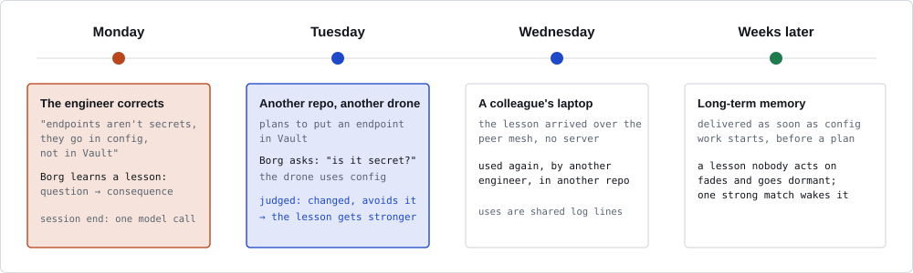
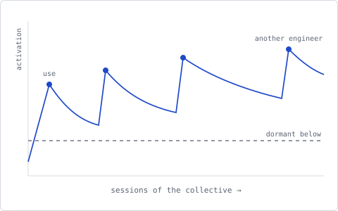
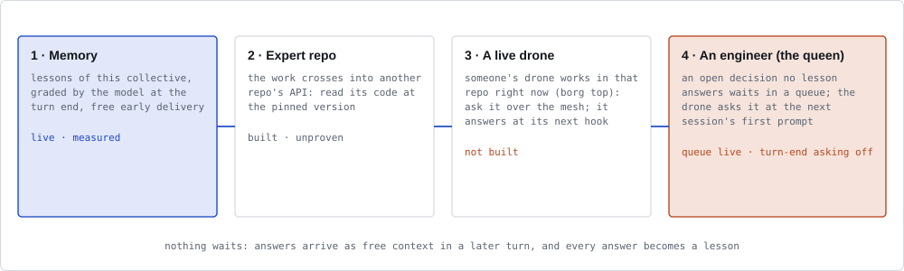
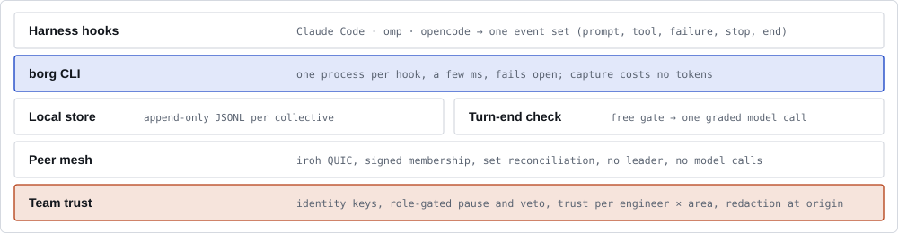

# How one session learns

[← README](../README.md)

Everything on this page works in one plain interactive session, with no team. A team adds other
people's lessons ([Team sync](team-sync.md)) and changes nothing else a session does, on every harness and
in both [delivery modes](delivery.md) (`crates/borg/tests/plain_cli.rs`).

A **drone** is one agent session. A **lesson** is what a correction becomes: a question the agent should
ask itself, the situations where it applies, and the consequence it prevents. A **collective** is one
shared memory for a set of repos and engineers.

- [Sources of lessons](#sources-of-lessons)
- [Outcomes and the usefulness belief](#outcomes-and-the-usefulness-belief)
- [Saying no](#saying-no)
- [Memory](#memory)
- [Reach and collectives](#reach-and-collectives)
- [The queen](#the-queen)
- [Also included](#also-included)

## Sources of lessons

**Corrections.** Borg records an *episode* when you push back on the agent ("no, use a channel") or
reject a tool call with a reason (Codex reports no rejected calls). At session end, `borg learn` makes one
model call per episode and writes a lesson. A new correction on the same point updates the existing
lesson.

**Team documents.** `borg assimilate --from-dir` condenses a checkout of written team knowledge into
scoped lessons, and its open decisions into queen questions ([Import](configuration.md#import-what-you-already-have)).

**Decision → fix links (regrets).** Some choices look fine and break weeks later. At session end Borg
links each landed commit to the earlier decisions whose lines it fixed. With `BORG_REGRESS=learn` a fix
becomes a lesson for the decision point; by default links are only recorded. How links are found, where
they are written and how to check them first: [Decision → fix links](configuration.md#decision--fix-links).

**Review → fix.** Most bugs never reach a commit. A workflow builds, a reviewer finds a problem, and a
fix step fixes it, all inside one session. `borg review-fix` reads the sub-agent runs of Claude Code
(workflows, and Agent-tool sub-agents; one a workflow's agent started joins that workflow's run), omp
(task agents), opencode (subagents) and Codex (spawned agents) at 0 tokens. It finds each reviewer
finding that a later fix step of the same run fixed and no verifier rejected. At session end those
findings become episodes, and `borg learn` words each as a question for the moment of building. On by
default; `BORG_REVIEW_FIX=off` turns it off. opencode, the Agent tool and Codex have no structured
output, so only reviewers told to answer in JSON yield findings there, and the Codex reader is built from
codex's serde names, not yet checked against a real spawned rollout. See
[Review → fix findings](configuration.md#review--fix-findings).

**Vetoes.** The reason of a `borg no` becomes a lesson at the next session end ([Saying no](#saying-no)).

**Playbooks.** A plain session that ends clean (it landed commits, its own last test run passed, and you
neither corrected nor vetoed it) is reflected on once at session end: `borg learn` asks the model for at
most one edit to the team's playbook for that kind of task. The task is the session's first task prompt,
not a later "commit it", and the change runs from where the session started to its newest commit. When
the model does not answer, the session waits in `playbooks-plain.txt` for a later run. The edit waits in
`borg queen` until you answer "promote". A later session whose prompt names at least 60% of the
significant words of the playbook's shape gets its steps. Built, preparation: no value metric yet. `BORG_PLAYBOOKS=off` turns it
off. See [Playbooks](commands.md#playbooks).

## Outcomes and the usefulness belief

Each delivered lesson gets an `asked` outcome, and what follows is recorded against it: `changed` or
`ignored` (judged by the next turn-end model call, see [Delivery](delivery.md)), `corrected` anyway,
`vetoed`, `regretted`, `tested`. These outcomes form each lesson's usefulness belief, which ranks it
against others and decides whether it keeps being asked. `borg debug memory <lessons.jsonl>` shows each lesson's
belief, activation and state. `borg debug ope` replays the hand-set weights offline against the logged asks,
with their asking probability, and reports; it never changes them.

| Outcome | Weight in the belief | Set by |
|---|---|---|
| a correction after the lesson was asked | 2 | design |
| `vetoed` | 3 | design, no eval yet |
| `regretted` | at most half a correction | design; on while its offline check is inconclusive, see [Evidence](evidence.md#regret-credit) |
| `tested` | 0.5 (`TESTED_W`) | design, not evaluated |

**Regret reaches back.** A regret learned as a lesson, from a later fix or a review finding, also counts
against the lessons asked in the deciding session before the decision: asking them did not prevent it.
The lesson it merged into takes the blame if it was asked; otherwise the asked lessons share it equally.
The blame grows with the fix's evidence (one signal 0.5, two 0.75, three 0.875; a review finding 0.5,
confirmed by a verifier 0.75). It costs 0 tokens, each regret counts once, and it weighs at most half a
correction, so a lesson that keeps being asked before decisions that break sinks slowly. A regret judged
"not a lesson", or one whose lesson went to a private store, blames nothing; outcomes are not synced yet,
so a decision made on another machine finds no asks here. `borg debug memory` and the page show it as
`regretted`; `BORG_REGRET_CREDIT=off` turns it off. Whether the default stays on is decided by a pre-registered
offline check: the belief with the regret term must predict later outcomes at least as well as without it.

**Green tests credit the question.** A session's own test runs count too. When a lesson was asked and the session's tests then failed and passed again, or passed after the
drone changed its work on the lesson's point, `borg learn` gives that lesson a `tested` result at session
end, once per session and lesson, at 0 tokens. The last run must pass; a pass before the question, a
question the drone ignored, or a lesson only handed over as context earns nothing, and a correction or a
veto of the lesson in the session outranks it. Borg tells a pass from a failure by the shell call's
output: Claude Code and Codex send it, and the omp and opencode adapters send the last 4,000 characters
of a shell call's output (opencode with an `Exit code: N` line when it failed). A run whose result the
harness does not show counts as no run. That output stays on the machine; the `tested` outcome syncs to
the team like the others. `BORG_TEST_CREDIT=off` turns it off.

## Saying no

`borg no <reason>` (or a prompt that starts with "borg no") is your veto of what a drone is doing. It
costs 0 tokens and has these effects:

1. Every lesson the drone was shown in the session loses credit, weighed above a correction, so lessons
   that did not prevent the vetoed work sink.
2. The reason becomes a lesson at the next session end, like a correction.
3. When the reason names an invariant of the system, Borg proposes it as a constraint in `borg queen`;
   only you can ratify it. A ratified constraint is a standing lesson: it reaches every later session on
   every harness that takes context (and your team's, through the mesh), as soon as its scope is named,
   an unscoped one at the first prompt, marked as a ratified constraint. It reaches only where the
   lesson it came from reaches: a repo convention's constraint stays in that repo. Nothing blocks work
   on it yet.
4. In the session, the drone is told to stop and not argue the veto back.

The measure is the *repeat-veto rate*: vetoes that repeat an earlier one, which should fall toward zero;
`borg web` shows it. Name a drone on a teammate's machine with `--session` and the veto travels as a
signed steering directive (steer role needed). A veto of work that already merged, from a session the
queen never asked you about, counts as a missed escalation in the queen's attention score, shown in the
queen view; nothing optimises it. See [Saying no](commands.md#saying-no).

## Memory

Use strengthens a lesson; disuse lets it fade. A lesson unused for about 54 sessions of its collective
goes dormant. Only a strong match wakes it, and nothing is deleted. The clock counts sessions, not days,
so a holiday erases nothing. A team lesson ages with every session of the collective, a teammate's
included; a repo convention ages only with sessions started in its repo
([details](configuration.md#who-hears-a-lesson)).

## Reach and collectives

A correction about the code becomes a team lesson. One about how *you* like the agent to work (commit
style, AI attribution, branching) is personal: it goes to your private collective and never reaches the
team. A convention of one repo is delivered only there. See
[Who hears a lesson](configuration.md#who-hears-a-lesson).

Each repo path belongs to one collective, or to none:

- **team** collectives sync to their members over the [peer mesh](team-sync.md);
- **private** collectives (`"share": "local"`) never leave the machine;
- **off** repos are invisible: Borg returns before it reads or writes anything.

A session reads only its own collective's lessons.

## The queen

The queen holds the decisions no lesson answers: open decisions from team documents, proposed
constraints, playbook edits and reach questions. At the first prompt of a session the drone asks you one
question of that session's repo: Claude Code in its question dialog, the other harnesses at the start of
the reply. Answer
in the terminal with `borg queen` and `borg queen ask`. See [Answering the queen](commands.md#answering-the-queen).

When memory cannot answer, the design escalates. Steps 1, 2 and 4 are built; step 3 (a live drone) is
not:

## Also included

- `borg why <file>:<line>` shows the redacted reasoning behind a commit, kept as a git note
  (`refs/notes/borg`, never pushed), and both ends of a decision → fix link: "→ fixed in Y" on the
  decision, "← decided in X → fixed here" on the fix.
- `borg top` lists the drones running across the team; `borg steer` sends them a signed instruction.
- **Expert repos:** a collective can name local checkouts of its dependencies. A turn end that touches
  one gets at most three cited claims from that checkout, at the pinned version.

