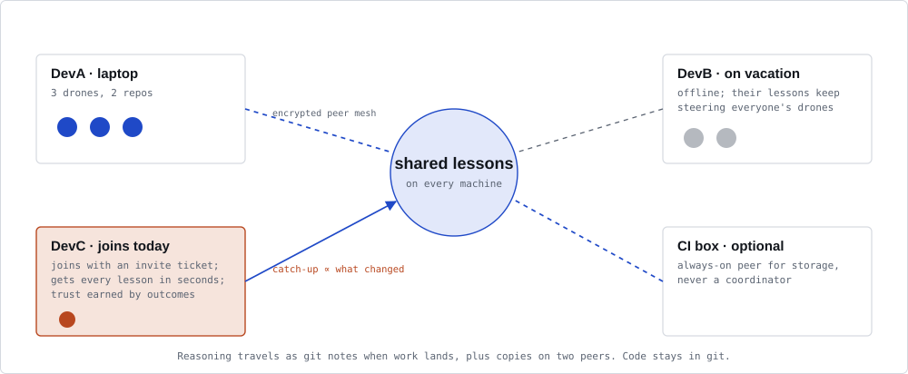
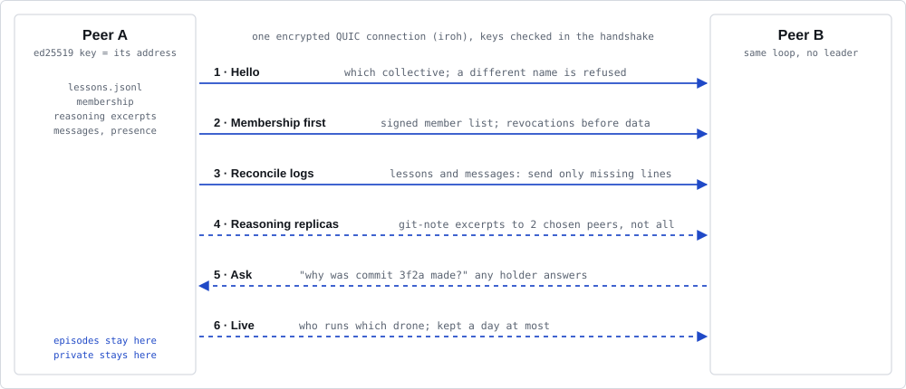

# Team sync

[← README](../README.md)

Members of a team collective share its lessons, statistics and messages machine to machine, with no server, across NATs (home
office, hotel, phone hotspot). Each machine runs `borg mesh serve`, a peer like every other. Hooks read
and write only local files, so agents never wait for the mesh, and Borg keeps working offline. The mesh
never calls a model.



- [Set up a team](#set-up-a-team)
- [Company collective](#company-collective)
- [How a sync works](#how-a-sync-works)
- [How peers find each other](#how-peers-find-each-other)
- [Privacy on the mesh](#privacy-on-the-mesh)
- [Troubleshooting](#troubleshooting)
- [Testing across real NATs](#testing-across-real-nats)

## Set up a team

Install `borg-mesh` next to `borg` (see the [README](../README.md#quick-start)). Private collectives and
off repos are refused before any connection opens.

`borg setup` covers both sides: it founds a team collective and runs `borg mesh init`, or joins one
with a ticket. The steps below are what it runs, for doing them by hand.

**1. Admin, once.** Inside a repo of the team collective (or with `--collective NAME`):

```sh
borg mesh init      # you become the collective's admin
borg mesh serve     # keep it running; syncs every 60 s and on local change
```

**2. Admin, per new member.** In a second terminal:

```sh
borg mesh invite                                            # prints a QR code and a ticket
borg mesh invite --role steer --expires 2d --uses 1 --png invite.png
```

Send the ticket privately (chat, password manager) or let the member scan the QR code: anyone holding
an unused ticket can join with its role. Defaults: role `member`, one use, valid 7 days. Roles are
`member`, `steer` and `observe`. Every role syncs. Only `steer` and `admin` may pause, resume and veto
sessions on other members' machines; a `member` or `observe` machine's pause counts nowhere but on its
own machine. `borg mesh invites` lists open tickets; `borg mesh invites --revoke <id>` withdraws one.

**3. New member.** Install Borg, then:

```sh
borg mesh join BORG1... --paths ~/work            # dry run: shows the collectives.json change
borg mesh join BORG1... --paths ~/work --apply    # writes it (with a backup), dials the admin, joins, syncs
```

`--paths` names your repo directories for the team collective. Without it, `join` adds the
placeholder path `~/CHANGE-ME/repos-of-<name>`, which routes no repo: replace it, or join again with
`--paths`. Then keep `borg mesh serve` running in one of those repos (or with `--collective <name>`).

The admin's `serve` must run while the member joins. It checks the ticket's signature, expiry and
remaining uses, adds the member's key to the signed membership and hands over the history. Other
members learn of the newcomer at their next sync. Spent, expired and withdrawn tickets fail. A revoked
key cannot rejoin with an old ticket; an admin must re-invite it by key.

**Other commands:** `borg mesh members`, `borg mesh revoke <key>` (admin), `borg mesh id`,
`borg mesh sync <key>` (once), `borg mesh peer [<key>[@<ip:port>]]`, `borg mesh fetch [<commit>...]`
(reasoning notes from members). `borg mesh serve` listens on `0.0.0.0:7878` and syncs every 60 s;
`--bind IP:PORT` and `--interval SECS` change that. `borg mesh invite <key> [--role R]` adds or
changes a member by key; with `borg mesh join membership-history.jsonl` it is the older manual flow.

## Company collective

There is no separate company type. A company collective is a team collective (`"share": "team"`) with
the settings a company network needs: its own relay, confidential repos kept `off`, and often a mirror
for the vector model.

**Admin, once:**

```sh
borg setup --team acme --paths ~/work/acme --relay https://relay.acme.example
borg mesh serve --collective acme      # keep it running, as a service
borg mesh invite --collective acme     # one ticket per member
```

Setup asks for the repos no collective may ever see (`off`) and where every other repo goes; it then
runs `borg mesh init` and offers a first invite (with `--relay disabled` it names the next step instead:
`borg mesh serve`, then `borg mesh invite`). Without `--relay` it asks: n0's public relays,
`disabled` (LAN or VPN only), or a company relay URL. Choose the relay before the first invite: each
ticket carries it and `join` copies it, and every member must use the same one.

**Each engineer:**

```sh
borg setup --join BORG1... --paths ~/work/acme
```

Setup runs `borg mesh join BORG1... --paths ~/work/acme --apply`, which writes the collective with the
admin's relay, joins and syncs. Then keep `borg mesh serve --collective acme` running.

**Relay.** A company relay keeps even the metadata in-house: the `iroh-relay` binary
(`cargo install iroh-relay@1.3.0 --features server --locked`) on a host with a DNS name and a TLS
certificate. [Running your own relay](relay.md) covers ports, TLS, the config file, a systemd unit, a
container, load balancers, access control and two relays for redundancy. `"disabled"` needs no relay
but reaches only peers on the same LAN or VPN, given as `<key>@<ip:port>`.

**Proxy.** The mesh does not use `HTTPS_PROXY`. A proxy that re-signs TLS works when its CA is in the
system trust store ([Privacy on the mesh](#privacy-on-the-mesh)). Where the only way out is an HTTP
proxy, run a relay inside the network, or use `"disabled"` over the VPN.

**Vector model.** Setup downloads it with `curl`, which does honour `HTTPS_PROXY` (and
`CURL_CA_BUNDLE` for a re-signing proxy). When the download fails, setup asks for a mirror URL. Set it
in advance with `BORG_VECTOR_URL=https://mirror.acme.example/potion-multilingual-128M`: a mirror serves
the three model files of the pinned revision ([Vectors](configuration.md#vectors)).

## How a sync works



Each peer dials the members it knows every 60 seconds, and at once after a local change: the store is
looked at every 2 s. Each member is dialled on its own, so
one that does not answer (a laptop asleep) holds up no other. A failed dial is tried again 2 s later,
then after 2, 4, 8 … minutes (at most 30), and carries what the failed one missed. Whatever B learned
from A reaches C in B's next round. After each session that completed, dialled or
answered, a peer notes when it started in `mesh/synced.json` (per member key, local only): what it held
then has reached that member; a failed dial removes the member from it.

**Membership.** Each machine holds one ed25519 key per collective; the key is also its network address,
so a connection proves who is on the other end. The member list is a JSON document signed by an admin.
A peer accepts a new version only if an admin of the version it holds signed it, so a stranger cannot
add themselves, and two admins editing at once resolve the same way everywhere.

**Reconciliation.** A blake3 hash names each lesson line, so peers compare hashes, not contents. Both
sides split the hash space into 16 ranges and swap one fingerprint per range; differing ranges split
again until a small range lists its hashes. Then only missing lines travel. Merging is a union of
append-only files, so nothing is overwritten; when two machines improved the same lesson, the higher
version wins everywhere. Cost grows with what changed: a laptop back from three weeks' vacation
downloads three weeks of lessons.

**What travels.** Five logs, each line signed by the machine that wrote it and quarantined when that
machine is revoked:

- **Lessons.** Raw episodes stay where they were captured, so each is learned exactly once.
- **Statistics rollups**, one per machine, engineer and day ([Statistics](statistics.md)).
- **Outcomes**: which lesson was asked, what followed (including a veto, and a later regret's share of
  the blame), when, and the probability it was asked, with session, repo and regret hashed. Every
  member derives the same lesson usefulness and trust from them. `BORG_SHARE_OUTCOMES=off` keeps a
  machine's outcomes local.
- **Ratified constraints** (`borg no`, `borg queen`): the invariant, its lesson and who ratified it,
  never the veto's words. Every member's sessions get them as standing lessons.
- **Messages between sessions** (`borg tell`, `borg ask`, and `borg pause`, `borg resume` or a
  `borg no` aimed at another machine), already redacted, checked on read, and kept for 7 days. A
  message to `local` (written `local@<node>`) is for this machine's sessions and never syncs;
  `collective` (or `all`), `<session>@<node>` and replies do. The `seen` lines a recipient writes when
  it is shown a message travel too, under the recipient's own key: they acknowledge the message and pace
  its sender ([Pacing](commands.md#messages)). `borg tell` paces by the sender's window; a member offers
  and takes every tell and ask within the bound any window keeps (acknowledged, or at most 64 unread
  from one sender to one recipient within 10 minutes), which reads no earlier line, so pruning old lines
  never stops a message once written. It keeps the log within the same bound as `borg tell` (1 MiB per
  member and class of line). A pause,
  resume or veto from another machine counts only when the membership gives that machine the `steer`
  or `admin` role; any other is refused and counted as `steer_dropped`.

Beside the logs, each session tells the other machines which sessions run where (shown by `borg top`,
kept a day at most), and reasoning excerpts go to two members chosen by hash, so the "why" survives
its author going offline.

**Versions.** This release speaks `borg/mesh/14`: messages keep their whole text and carry `seen`
lines. It still syncs with a 0.4 or 0.5 peer (`borg/mesh/13`), which gets only what it can read: the
messages of at most 1,000 characters, no `seen` line, and at most one tell or ask per sender and
recipient every 10 minutes, as 0.5.0 paced them. Longer messages do not reach it: upgrade it. It also
still syncs with a 0.3 peer (`borg/mesh/12`), but messages do not reach that peer. Peers on
`borg/mesh/11` and earlier do not sync at all. Such a session ends at the handshake with a line in
`borg mesh serve`'s log, and `borg doctor` warns
("peer <key> speaks borg/mesh/5, this node borg/mesh/14: nothing syncs with it; upgrade it") until a
session with it completes or it leaves the member list. The old node's log gets the same line from its
side ("… upgrade this node").

**Revocation.** `borg mesh revoke <key>` re-signs the member list. Every peer that has it refuses the key
and drops lines it stamped after the revocation; earlier contributions stay. A revoked machine's
pause, resume or veto stops counting at the next sync, and so does one from a machine that lost its
steering role.

## How peers find each other

Peers are addressed by node id (their public key), not by IP. iroh connects them directly where it can
and punches through NAT on both sides. Where that fails (symmetric NAT, blocked UDP), traffic goes
through a relay. Pick the relay per collective (`BORG_RELAY` overrides it for all):

| `"relay"` | Reaches | Who sees metadata |
|---|---|---|
| absent or `"default"` | anywhere | n0's public relays and address lookup (DNS/pkarr) |
| `"https://relay.example.com"` | anywhere both can reach that host | your relay only |
| `"disabled"` | LAN or VPN only (direct `ip:port`) | nobody outside the network |

```json
{ "name": "platform-team", "paths": ["~/work"], "share": "team", "relay": "https://relay.example.com" }
```

A company relay is the `iroh-relay` binary on a host with a DNS name and a TLS certificate; see
[Running your own relay](relay.md). Several relays, comma-separated, give redundancy. Every member must
use the same setting; `join` copies the admin's.

`<key>@<ip:port>` works as a hint for `peer` and `sync`. With `"disabled"` it is required.

## Privacy on the mesh

Traffic is end-to-end encrypted (QUIC with TLS). Each end authenticates the other by key, and Borg checks
that key against the signed membership. A relay forwards packets it cannot read, and without a member key
it can neither join nor inject data.

A **public relay** (the default) and n0's address lookup see metadata:

- your node id (a per-collective key) and public IP address;
- which node ids talk, when, and how much;
- the relay URL each node uses (published to n0's DNS under your node id; no IP addresses).

They see no lesson, member list, repo name or email. To keep the metadata in-house, run a company relay,
or use `"disabled"` on a LAN or VPN. The default and self-hosted settings ask your router to open a port
(UPnP, NAT-PMP, PCP); `"disabled"` does not.

The relay's and the address lookup's TLS certificates are checked against the system trust store
(Mozilla's roots if the machine has none). A corporate proxy that re-signs TLS with a CA installed on the
machine therefore sees the relay traffic: the metadata above, but not the content, which stays
end-to-end encrypted between member keys.

## Troubleshooting

| Symptom | Cause and fix |
|---|---|
| `join` hangs, then says the admin did not answer | The admin's `borg mesh serve` is not running, or the two sides use different `relay` settings |
| `the invite was already used` / `has expired` | Ask the admin for a new ticket |
| `no relay connection yet` at `serve` start | The machine cannot reach the relay (offline, firewall, wrong URL). LAN peers still sync. Behind a proxy that re-signs TLS (a company VPN), its CA must be in the system trust store |
| `no direct address ... relays are disabled` | With `"relay": "disabled"`, give peers as `<key>@<ip:port>` |
| `collective "x" is not in …/collectives.json` | Run `join` with `--apply`, or add the entry by hand |
| Nothing syncs after joining | Replace the placeholder path (or join again with `--paths`); `borg collective <repo>` must name the team collective with `may sync: true` |

## Testing across real NATs

The automated tests cover tickets, a join on localhost, and a join and sync between two nodes that can
reach each other only through a local relay. Real NAT traversal needs a manual test:

1. **Machine A** (home or office network): `borg mesh init`, then `borg mesh serve`. The `reachable at`
   line should list a relay URL.
2. **Machine B** on another network (a phone hotspot is a different, often carrier-grade, NAT):
   `borg mesh join <ticket> --apply` with a ticket from A's `borg mesh invite`.
3. Expect `joined <name> ... first sync: ... received N`. Run `borg mesh serve` on B, add a lesson on
   either side, and watch for `synced` lines on both within a minute.
4. **Negative check** on B: `BORG_RELAY=disabled borg mesh sync <key of A>@<A's LAN ip:port>` must fail.
   That proves the relay or hole punching carried step 3.
